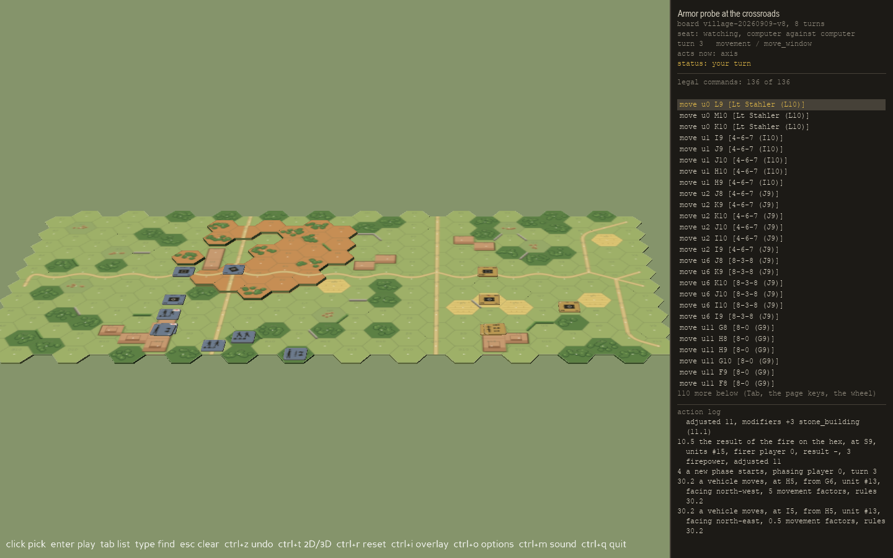
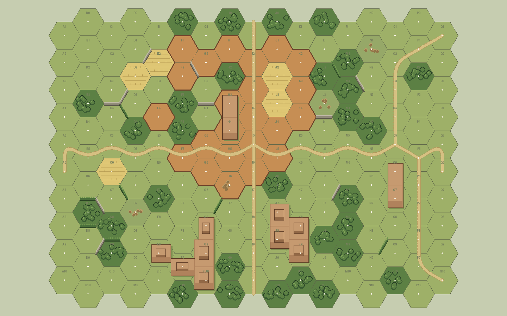
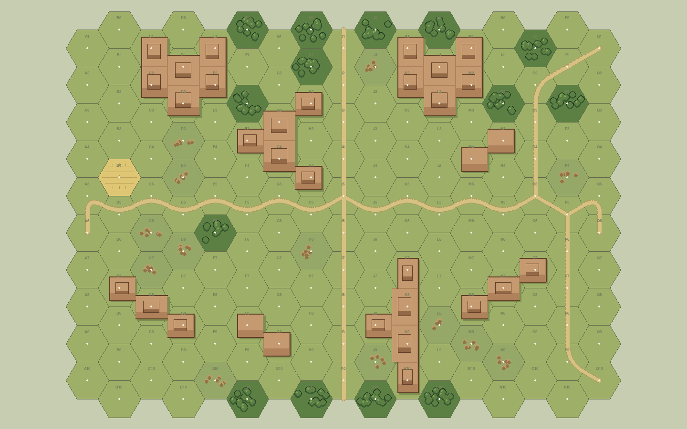
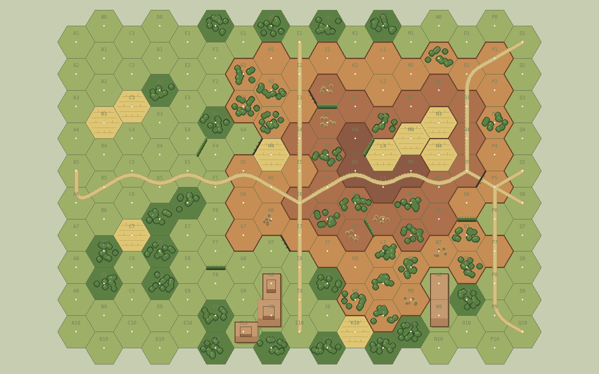
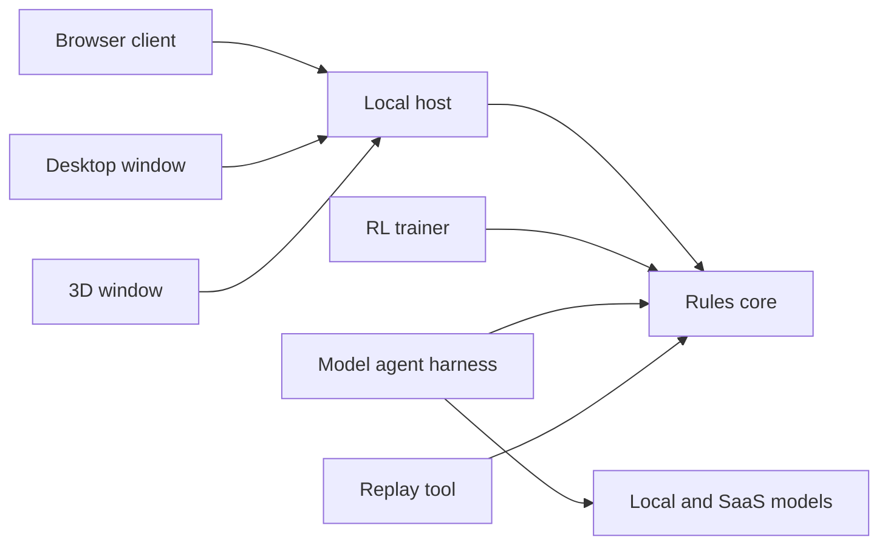

# Squad Leader Expeditionem

The repository name is `Squad_Leader_AI`. The public title of the game is Squad Leader Expeditionem. The window captions show that title.

An edition of the 1977 Avalon Hill board game Squad Leader, with the 4th edition rules. It has a rules engine that shows the rule number for each result, and computer opponents that learn. It plays in a browser or in a window of its own on Windows and on Unix.

This project is not affiliated with, sponsored by, or endorsed by Hasbro or Multi-Man Publishing. It ships no Avalon Hill art, scans, board layouts, or rulebook text.

## Play the game

`docs/PLAYER_GUIDE.md` tells you how to play: the set up, the move, the fire, the victory
conditions, the keys, and how to continue a saved game. The package for players has it as
`HOW_TO_PLAY.md`.

A player with no Python uses the package and its launcher (see "The package for players,
and the collection of played games"). From the source tree, install the game with one
command, and then start a game against the computer:

```
python -m venv .venv
# Linux or macOS:     source .venv/bin/activate
# Windows PowerShell: .venv\Scripts\Activate.ps1
python -m pip install -e ".[play]"

sl-cli launch
sl-cli window3d --scenario lib01_grain_office --agent hard
```

- `sl-cli launch` opens the menu of the package: the scenario, the side, the opponent, and
  the window.
- `--agent easy`, `normal`, or `hard` sets the computer opponent (agent v5, v6, or v7).
  `--agent-side` gives the computer a side by its key in the scenario: `allied` or `axis`
  in the library scenarios and in s04, and `german` or `russian` in s01 to s03a. The default
  is the second side. With no `--agent` two persons play at one screen. `--agents v7,v6`
  lets two computer opponents play, and the window shows the game.
- The 12 library scenarios are `lib01_grain_office` to `lib12_the_long_front`. The tree
  also has `s01_guards_counterattack`, `s02_tractor_works`, `s03a_streets_of_stalingrad`,
  `s04_armor_probe` (the armor game), and three test scenarios (`s00_movement_drill`,
  `s00b_combined_forces`, `s00c_two_board_advance`).
- On Windows, `play.bat` at the top of the tree starts `lib01_grain_office` against the
  `normal` opponent. `resume.bat` continues the newest saved game in `runs/games/`. Type
  `.\play.bat` or `.\resume.bat` in PowerShell, with no options.
- `--no-briefing` starts the game with no scenario card.

The game saves after each command to `runs/games/<game_id>.jsonl`. The window gives the
path when it starts. To continue a game:

```
sl-cli window3d --resume runs/games/<game_id>.jsonl
```

## What it looks like

[](docs/media/gameplay_3d.mp4)

The video [`docs/media/gameplay_3d.mp4`](docs/media/gameplay_3d.mp4) (2 min 49 s, 27 MB) is a game of the armor scenario in the 3D window, between two computer opponents. It starts with the scenario card. Then the units move and fire on the 3D board, with the tracers and the sound, to the end of the game. It is a screen recording of 2026-10-10, before the change of scenario 4 to 8 turns.


The 3D window in its 2D camera mode (Ctrl and t), in turn 3 of the armor scenario. Each counter is a card with the figure of its unit and its factors. The panel gives the turn, the phase, the legal command list, and the action log with the rule ID of each result.

Three boards from the generator, drawn by the same code:

| A village | A city | Hills |
|---|---|---|
|  |  |  |

Each terrain is a shape on the ground and not a hexagon of colour. A wood is a mass of
crowns. A building is the plan of a structure that can cover more than one hex. A road is a
ribbon that turns. A hill is a flat brown area with a crest line where the level changes.

`tools/make_docs_images.py` makes these pictures from the generator, the board drawing, and the 3D window. The game pictures have to have the `view3d` extra.

`docs/images/MANIFEST.json` gives the seed of each one, the release audit reads that
manifest, and `tests/docs/test_documentation_images.py` makes each picture again and
compares it. So each picture in this repository is the output of the code in it. A scan
that gets into that directory stops a test, and the audit reports it (SR-07). The video is the one file that the tool does not make. `docs/ASSET_PROVENANCE.md` records its source.

## What it is

One rules core with no input or output plays rules 1 to 44 of the 4th edition text. That is the infantry game, the armor game, hills, hidden placement, and the rural terrain. The core keeps the rule ID of each rule it applies. The action log shows the rule, the dice, and the modifiers for each result, for the two sides. A local host owns each game. Each outbound message is a view for one seat.

A player sees that player's own units. A concealed enemy is a counter. A hidden enemy is not in that view. In a LAN room the legal command list goes to the seat that acts. The idle seat gets an empty list. Hot seat keeps the list.

The boards come from a generator in the 1977 look, and the counters are new art from the 1977 values.

Four play modes: two humans at one screen, or two clients on one LAN with a room code. Also a human against a computer opponent, and two computer opponents in a headless tournament. A client is the 3D window, the 2D window, or a browser. The 3D window is the primary front end.

Four families of computer opponent, behind one interface:

- scripted agents with named parameters
- learned agents, neural networks from self-play reinforcement learning
- prompted model agents, local or SaaS language models that select from the legal command list, with the odds of each command in the prompt
- tuned model agents, local language models fine-tuned on the game's own traces

## How it works



The core gets a state and a command and gives a new state, the events with their rule IDs, and a hash. A game is its seed, its switches, and its command log. A replay reproduces the hash sequence or it is a defect.

## Hardware and runtime

| Component | Target |
|---|---|
| Owner workstation | Windows 11, one NVIDIA GPU. Linux also supported. |
| Core, host, trainer, harness | Python 3.12 or a subsequent version |
| Client | The 3D window with Panda3D and the 2D window with pygame-ce, on Windows and on Linux. Also a browser client in TypeScript and Vite |
| Local models | An OpenAI-compatible server (llama-server, Ollama, vLLM, LM Studio) on the LAN |
| SaaS models | Claude, OpenAI, Gemini, xAI, and Mistral (`src/sldata/providers.json`) |
| Training | PPO in raw torch on one GPU. A LoRA fine-tune of a 7B to 14B model on one GPU |

## Quick start (development)

The commands:

```
python -m venv .venv
# Linux or macOS:     source .venv/bin/activate
# Windows PowerShell: .venv\Scripts\Activate.ps1
python -m pip install -e ".[dev]"
python -m pytest tests/

# For the trainer, which needs torch:
python -m pip install -e ".[train]"

# For the desktop window, which needs a 2D game library:
python -m pip install -e ".[desktop]"
```

The other extras of `pyproject.toml`: `play` (the two windows), `view3d` (Panda3D only),
`browser` (Playwright, for `tests/browser/`), `shape` (`sl-cli shape`), `finetune`
(`sl-cli finetune`), and `package` (PyInstaller, for `tools/package.py`).

The first run of `pytest tests/` has some failures in the tests that compare the windows
with the browser client (`tests/browser/test_render_constants.py`, `test_play_ui.py`,
`test_strict_status.py`, `tests/host/test_annotate_coverage.py`, and
`tests/window/test_road_sides.py`). The browser client in `client/src/` is older than the
windows, and these tests stay unsatisfactory until the newer client comes in. A test of
`tests/browser/` also has to have the `browser` extra and `python -m playwright install
chromium`.

On Ubuntu and on Debian, `python` is not a command. Use `python3`, and install the two
packages that make a virtual environment:

```
sudo apt install python3-venv python3-pip
python3 -m venv .venv
source .venv/bin/activate
python3 -m pip install -e ".[dev,desktop,view3d]"
```

On a machine with no NVIDIA card, install the processor build of torch. The default
wheel of torch adds about four gigabytes of CUDA libraries that such a machine cannot
use:

```
python3 -m pip install --index-url https://download.pytorch.org/whl/cpu torch
python3 -m pip install numpy pettingzoo gymnasium tensorboard
```

The browser client is in `client/dist`, and the host serves it. Node is necessary only
to build the client again (`cd client && npm install && npm run build`).

Then play, measure, and compare:

```
sl-cli play --scenario s01_guards_counterattack --games 3 --verify
sl-cli gate --scenario s01_guards_counterattack --games 100
sl-cli bench --scenario s01_guards_counterattack --workers 1,8,16 --minutes 10 --out runs/bench/stats.json
sl-cli tournament --agent-a v1 --agent-b v0 --games 20
sl-cli gauntlet --candidate v7 --panel random,v1,v4,v5,v6 --games 20 --workers 16
sl-cli gauntlet --candidate "v7[loss_scale=12,fire_floor=4]" --panel v1,v5,v6 --games 40 --anchor-only --workers 16
sl-cli gauntlet --candidate "model:local*" --panel v7,v6 --games 8 --anchor-only --workers 4 --progress
sl-cli gauntlet --candidate random --panel v3,v5,v6,v7 --scenarios s04_armor_probe --games 40 --anchor-only --mirror --workers 16
sl-cli evolve --base v7 --panel v7,v6 --games 16 --generations 12 --workers 16 --progress
sl-cli shape --record --analyze --pairs v7:v7,v7:v6,v6:v6 --games 60 --workers 8 --out runs/shape_s01
sl-cli runs --rebuild
sl-cli boards --count 1000
sl-cli boards --write runs/boards --count 12
sl-cli agents --list
sl-cli agents --games 100
sl-cli imitate --teachers v4,v5,v6 --labels 0=v5,1=v6 --games 450 --epochs 10 --dagger-rounds 3 --dagger-games 150 --workers 16 --eval-games 20 --out runs/imitate/snapshot-0.pt
sl-cli train --steps 1000000 --player both --start-from runs/imitate/snapshot-0.pt --anchor-kl 0.5 --workers 16 --rollout 2048 --minibatch 256 --eval-games 20 --device cuda --tensorboard runs/tb
sl-cli train --scenario s04_armor_probe --player 0 --opponents v7 --jump-start v7 --jump-start-turns 3 --value-warmup 100000 --start-from runs/imitate_s04_large/snapshot-0.pt --workers 16 --rollout 2048
sl-cli window --scenario s04_armor_probe --agents v1,v2
```

`sl-cli window` opens a window of its own with no browser. With no address it starts a
host in the same process. It then connects to that host on the loopback address, which is
the path the browser client takes. `--connect ws://host:port/ --room-code CODE` connects to
a host that operates at this time.

The 2D window has the menu of a unit (a right click, or Ctrl and Space) and the Undo
button of the panel, as the 3D window has. A unit of your side in focus shows its pale
blue hexes in the Movement Phase, and its field of fire in a fire phase. A click on a
pale blue hex moves the unit there. The 2D window has the set up tray too, with the same
clicks, drags, and buttons.

In the window: a click puts the top unit of a hex in focus. A second click takes the next
unit of the stack. The overlay shades the hexes that unit can move to, the hexes it can
fire at, and the track it moved on. With no click the focus is the unit that acted last.
So a game of two computer opponents shows the marks of the unit that plays.

The pointer on a hex shades the line of sight from the focus unit to that hex, from the
answer of the host. A fire is a thin dashed line in the tone of its phase: the prep fire,
the defensive fire, or the advancing fire. A small burst on the target shows the result.

The arrow keys and the wheel move the board and change its dimension. Ctrl and f fits the
board in the window, Ctrl and s writes a picture, Escape clears the focus, and Ctrl and q
stops. A person who only watches can use these letters without Ctrl. For a seated person,
a letter goes to the filter of the list.

When the host sets strict mode, the line of sight answer is for a fire phase only.

`sl-cli window3d --agents v6,v6` shows the same game in a 3D window. It has the same
overlay, the same click, and the same pointer, and it adds the fire animations and the sound. The `play`
extra installs it (`pip install -e ".[play]"`). Ctrl and i hides the overlay, and Ctrl and o
hides the options of the focus unit. `docs/PLAYER_GUIDE.md` gives the keys for a person.

`python tools/make_docs_images.py` makes the pictures that this file shows. Run it after a
change to the board drawing. The test in `tests/docs/` compares what the tool makes with
what the tree holds.

`--workers` is a count from 1 to 64. A larger count is an error. `sl-cli bench` gives exit code 0 when the measurement is complete and the best rate is 3,500 steps each second or more. A lower rate gives exit code 1.

An agent name can name a nation and a parameter study. `v7:german` and `v7[loss_scale=8]` are names the play, host, window, campaign, and gate commands accept. A bad name gives a failure in `make_agent`, and the message names that name.

The welcome message has `strict_los`. The browser shows that flag as text. The page has no mode control, and the client does not send a mode. In strict mode the host answers a line of sight question only in a fire phase (rule 19.3).

A learned snapshot from 2026-09-22 or earlier does not load. The observation uses the player view, and the policy has a fourth head for two commands that share a unit, an action, and a hex.

`sl-cli boards --count 1000` is the board gate. It makes the boards, checks the geomorphic edges, connects each board to the next, sets scenario 1 up on it, and writes a run artifact. `--write` puts the board documents in a directory for the owner's scoring session.

A run artifact goes in `runs/<ISO8601-Z>-<slug>/` with a manifest, the command log, the action log, and the statistics. `runs/runs.sqlite` indexes them. `sl-cli runs --rebuild` deletes the rows and writes the new rows in one transaction. A bad artifact does not empty the index. Git does not record the run directory or the index.

API keys for SaaS providers go in `claude.key.txt`, `openai.key.txt`, `gemini.key.txt`, `mistral.key.txt`, and `xai.key.txt` at the project root. `.gitignore` lists them on its first line. A missing key marks that provider unavailable and stops nothing else.

## The package for players, and the collection of played games

The package is one folder with the game executable. A player does not install Python. The executable starts the launcher. At the first start, the launcher shows a question: can the game send the recorded games?

Then it shows a menu of the 12 library scenarios, the side, the opponent, and the 2D or the 3D window. The opponent is the computer at three levels, a person at the same computer, or a person on the LAN. Each game window is a second process of the same executable.

Build the package on each system. PyInstaller does not build for a different system, so run the build on Windows for the Windows package and on Linux for the Linux package:

```
python -m pip install -e ".[play,package]"
python tools/package.py                                   # the collector is tars.uberadmin.com:5170
python tools/package.py --collector https://collect.example.org
```

The output is `dist/SquadLeaderExpeditionem/` and an archive: `SquadLeaderExpeditionem-<version>-windows-x64.zip` or `...-linux-x64.tar.gz`. The Windows folder is 142 MB, and the archive is 58 MB. `--dist DIR` writes to a different folder, and `--no-archive` makes no archive. The package does not have torch or numpy, so the menu offers the scripted computer players only.

The folder has these texts:

- `READ_ME_FIRST.txt` (`tools/package_readme.txt`): how to start, how to continue a saved game, the player key, and what the game sends.
- `HOW_TO_PLAY.md` (`docs/PLAYER_GUIDE.md`): how to play.
- `THIRD_PARTY.txt` (`tools/package_third_party.txt`) and `licenses/`: the licence of each third-party part.

The build removes the files of the libraries that the game does not use (`PRUNED` in `tools/package.py`). The build stops if a key file is in the folder.

Each game saves to the data directory of the player: `%LOCALAPPDATA%\SquadLeaderExpeditionem\games` on Windows and `~/.local/share/squad-leader-expeditionem/games` on Linux. The save file is the full record of the game: the seed, the switches, and each command with its source (`human`, `agent`, `route`, or `forced`). The trainer makes each position and each decision again from it. A game with no command of a person stays on the computer.

In a LAN game only the host computer has the save file, and it records the commands of the two persons.

When the player agreed and has a player key, the launcher sends the games at its start and after each game. The collector checks the key, plays each game again through the core, and keeps it. When the hashes of a game do not agree with the replay (a different version of the rules), the game goes to a different folder.

- Make a key for each player on the workstation: `sl-cli collect key add <name>`. The store is `collect_keys.key.txt`, and the player file is `collect_players/<name>/collect.key.txt`. Give the player that file. It goes next to the game executable. `sl-cli collect key revoke <name>` stops one key.
- Install or update the collector on tars: `python tools/collect_deploy.py`. After a new key, `python tools/collect_deploy.py --keys-only` copies the store, and the collector reads it with no restart.
- The collector listens on port 5170 and keeps the games in `~/squad_leader_collect_data` on the host: `games/` (verified), `unverified/`, and `index.jsonl`. `sl-cli collect status --data <folder>` gives the counts.
- To run a collector by hand: `sl-cli collect serve --data collected --keys collect_keys.key.txt --bind 0.0.0.0 --port 5170`. These are the default values. `--bind 127.0.0.1` keeps it on the local computer. `sl-cli collect key list` gives the names of the keys.
- Each request has an HMAC with the player key, a time, and a nonce. The key does not go on the network. The server is plain HTTP. An Internet collector must have TLS in front of it.
- `sl-cli collect send` sends the saved games of a computer by hand. `sl-cli launch` starts the launcher from the source tree.

A LAN game: the host selects "you are the host". The launcher shows the address of the computer and a room code, and the host window accepts connections on port 8731. The other person selects "join a game" and types the address and the code.

From the source tree, the host starts `sl-cli window3d --scenario NAME --lan --lan-port 8731 --room-code CODE`. The other person starts `sl-cli window3d --scenario NAME --connect ws://ADDRESS:8731/ --room-code CODE`. With `--lan` and no `--lan-port`, the host accepts connections from the same computer only.

## The game farm

The game farm adds the processors of other Linux computers to a gauntlet or an evolution. Each farm host runs `sl-cli farm serve`, and `sl-cli gauntlet` and `sl-cli evolve` send games to it with `--remote`. The host plays each game in a pool of its own, and the workstation puts the results in the order of the job list. Thus a run with the farm writes the same artifact as a run on one computer.

- The farm plays the scripted agents only (`random`, `v0` to `v7`, with a nation or a parameter set). A learned agent reads a snapshot file, and a model agent uses the network and a key. Play those with `--workers`.
- Each connection proves the farm key with an HMAC of a random value. The key does not go on the network. The key file is `farm.key.txt`, and `.gitignore` covers it with `*.key.txt`.
- A job is data: a scenario of the host, a seed, and two agent names. The host checks each of them, and it runs no code from the network.
- The host and the workstation compare a hash of `src/`. A host with other code is refused, because a game is its seed only on the same code. Copy the tree again after each change.
- When a host fails, its games go to the other hosts and to the local workers.

Install or update the worker on the hosts with one command on the workstation. Run it again after each change of the code:

```
python tools/farm_deploy.py tars        # one host
python tools/farm_deploy.py             # tars, case, kipp, and plex
```

For each host, one ssh connection (`rdilley@<host>.uberadmin.com`, with your ssh keys) copies the code, `farm.key.txt`, and `tools/farm_worker.sh` to `~/squad_leader`. Then it runs that script on the host. The script stops the worker that runs, makes `.venv`, runs `pip install -e .`, and starts `sl-cli farm serve` on port 5160. The worker writes `~/squad_leader/farm.log`.

A host needs `python3-venv` and a firewall rule for port 5160 one time: `sudo apt install python3-venv` and `sudo ufw allow from <workstation address> to any port 5160 proto tcp`. Make `farm.key.txt` one time with `sl-cli farm key --write farm.key.txt`.

Use the farm from the workstation:

```
sl-cli farm ping --remote tars,case,kipp,plex
sl-cli evolve --base v7 --panel v7 --scenario s04_armor_probe --side axis --workers 16 --remote tars,case,kipp,plex
sl-cli gauntlet --candidate v7 --panel v3,v5,v6 --scenarios s04_armor_probe --games 200 --workers 16 --remote tars,case,kipp,plex
```

PPO training uses the farm too. Each farm host holds PPO workers, and the trainer on the workstation batches their decisions on the GPU with the decisions of the local workers:

```
sl-cli train --scenario s04_armor_probe --player 0 --opponents v7 --workers 16 --remote tars,case,kipp,plex --device cuda
```

The farm plays random and scripted opponents only, so a training run on the farm must have `--opponents`. A league snapshot is a file of the workstation. `--remote-envs` is the count of PPO workers on each host, and the default is the slots of the host. On the workstation, one bridge process for each host holds the connections of its PPO workers.

When a remote worker stops, the run continues without it while 50 percent or more of the workers are live. The `dropped_workers` field of the run artifact names each worker that stopped. The trainer writes a snapshot at each multiple of `--snapshot-every` and at the end of the run.

Use `--rollout 4096 --minibatch 1024` on the farm. At the default rollout of 512, each worker gives only approximately four decisions before the update, and the farm is not faster. With these values, the farm and 16 local workers gave 1,789 steps/s for a full s04 run of 40,000,000 decisions (2026-10-15). 16 local workers alone give 288.5 steps/s with the default values. The worker script installs the `train` extra on each host, with the CPU build of torch.

```
sl-cli train --scenario s04_armor_probe --player 0 --opponents v3,v6,v7 --start-from runs/imitate_s04_new/snapshot-0.pt --anchor-kl 0.5 --rollout 4096 --minibatch 1024 --workers 16 --remote tars,case,kipp,plex --device cuda
```

A name with no port uses port 5160. The server listens on 127.0.0.1 unless it gets `--host`. `--slots` is the count of game processes on the host. The default is the processor count less two.

## Status

| Item | State |
|---|---|
| Research report with ten appendices | Done |
| Vision, Requirements, Success Criteria | Done, after two multi-AI reviews |
| Architecture | Updated 2026-10-28 to the code as built |
| Code | Rules 1 to 44, the 12 library scenarios, and scenarios 1 to 4. The conformance corpus, replay, run artifacts, the tournament, and the host. The 3D window, the 2D window, and the browser client. The board generator, the computer players, and the farm. The package and the collection of played games |
| v0.1 headless rules proof | Complete. A run artifact records each of the gates TC-01, TC-02, TC-04, TC-05, TC-08, TC-09, TC-10, and TC-38 |
| Throughput | 9,279 environment steps/s at 8 workers on the complete scenario 1 for 10 minutes (2026-09-24, `runs/bench_nfr01_20260924_w8.json`), against a gate of 3,500 |
| v0.2 browser hot seat | The host, the client, and the browser test are done. BC-01 waits for the owner to play one game |
| Board generator | Five passes and four board types: city, hills, village, rural. Each type has a style record. TC-14a holds on 1,000 seeds. Generated mode plays scenario 1 with zone set up areas |
| Hills | Rule 43: three levels, crest lines, the height advantage, and the blind hexes. The client draws the hill shades and the crest lines |
| Release audit | `python tools/audit_release.py` reads the tree, the built page, and the run artifacts for TC-25, TC-28, and TC-29. It reports zero findings |
| Model agents | Five SaaS providers and five local endpoints, with one adapter for each of the three API shapes. The prompt gives each legal command its odds from the tables of the core and holds the victory conditions of the card. The cycle guard offers the model no command that gives a position the phase had. So a model cannot drop and pick up one weapon for hours. The tournament and the gauntlet record the rates of each model agent of each game |
| Rules 22 to 27 | Flamethrowers, demolition charges, smoke, concealment, fanaticism, and sewer movement, with scenarios 2 and 3A |
| Armies | German, Russian, and American counters, with the values of RV-1. A side can field two armies, and one project scenario starts with all three |
| Boards side by side | FR-29: two to four generated boards make one playing surface, along the long edges or the short edges, with a turn of 180 degrees |
| Computer against computer | `sl-cli host --agents v1,v2` plays a game by itself, and a browser shows it. The browser harness plays a full game and checks the client, the rules, and the agents |
| Armor game, the vehicle | Rule 28 to rule 32. The printed values, the covered arc, the movement chart, passengers, and the hull as cover |
| Armor game, the fight | Rule 33 to rule 41. The to-hit table, the kill table, overruns, infantry against armour, the panzerfaust, the bazooka, malfunctions, immobilization, and wrecks |
| Armor scenario | `s04_armor_probe` is the first game that plays rules 28 to 41 |
| Desktop window | `sl-cli window` opens a window of its own on Windows and on Unix, with no browser. It shows the buildings, the trees, the walls, the hedges, the cliffs, the roads, the hills, the wheat, and the shellholes. It also shows a vehicle with its covered arc |
| Tactical overlay | One model for the 2D window and the 3D window. The unit in focus and its marks are shaded hexes. The line of sight from the host is shaded hexes. A fire is a thin dashed tracer in the tone of its phase, and the result is a small burst. A ghost stands on the track hex of a unit that the defender put back with rule 16.1 |
| Terrain drawing | Each terrain is a shape on the ground and not a coloured hexagon. The style is flat shading: a lit face, a body, a shaded face, and a line. The window and the browser hold one set of colours, and a test compares the two files |
| Rural terrain | Rule 44: a wheatfield that stops sight through it, a seasonal crop, the shellhole modifier, and cliff hexsides on a hill |
| Hidden placement | Rule 42: a side the scenario names records a unit in a woods hex or a building hex, and the other player sees nothing of it |
| Design your own | Game Set IV: a force point scale, random scenario construction from a seed, and the campaign game. A personal leader holds a rank, and the rank follows the record |
| Agents | Eight scripted agents with named parameters, and a learned agent with PPO on the GPU, a league, and an Elo table. Agent v3 is the tanker. Agent v4 adds the threat map of v1. Agent v5 adds vehicle fire and suppression fire. Agent v6 is the tempo agent: the attacker keeps a schedule and moves on a path that the threat weights |
| Agent v7 | It trades on the odds: the expected result of each fire from the tables of the core, with no die. It puts the smoke of rule 24 down by the same odds. A nation record of v7 goes by the role of its side: `v7:german` is the defence record where the German defends, and the attack record where it attacks |
| The local model pool | `model:local*` is the pool of the five llama.cpp servers of the owner's network: four desktops and the workstation's RTX 5090, one model each. The seed of a game picks its host and the others are its failover, so `sl-cli gauntlet --workers 4` keeps the four desktops busy. A `request` field of a provider row goes into each request, and the local rows turn the thinking of Qwen3 off. `sl-cli gauntlet --progress` prints one line for each game that ends |
| Parameter evolution | `sl-cli evolve` runs a (mu + lambda) evolution strategy on the named parameters of v7. Each candidate of a generation plays the same seeds against a fixed panel as each side. The elites play again in each generation, and the artifact names the best as a `v7[...]` text a person can play |
| The shape study | `sl-cli shape` records the position at the end of each Movement Phase and each Advance Phase of many games. A position is a picture and a set of shape statistics, with the winner. The analysis gives the AUC of each statistic between the winners and the losers. It gives the information of the shape on top of the material in a cross validated model, and a picture net with its occlusion map |
| The odds | `slagents.scripted.odds` gives the expected result of a fire group at a hex, as counts out of 1,296. It reads the same fire functions as the core. A leader who breaks does not help the next unit in that hex. A chain of hexes uses the rating that helps the firer less (QA-15.2). One test on 1,500 game positions agrees with the core. v7 and the model prompt read only the enemy units the player can see, and v7 forms a fire group by that loss |
| Rules, 2026-09-23 | The armour kill modifier goes on the attacker dice. A flamethrower, a demolition charge, a panzerfaust, and a bazooka stay out of a fire group. A squad fires at most four panzerfausts in one player turn. Canister fire and machine-gun fire spend an empty hex and stop on a wall. A killed unit drops its weapons, and close combat removes a broken squad first. A leader on a machine gun does not modify morale |
| Learner, 2026-09-23 | The policy has four heads, and the option list holds 64 commands. The planes and the sneak term omit a hidden or concealed enemy. The load uses `weights_only=True`. A provider redirect is an error, and the key stays on the first host. A factory hex that each side counts pays one time |
| Host, 2026-09-23 | An unjoined socket gets no frame. An incorrect room code closes the socket. A second join from a connection that holds a seat is refused. The origin check uses the address the server bound. The 3D side panel writes a draw error to the error stream and keeps the last good panel |
| Training methods | Imitation of the scripted agents with DAgger rounds. Then PPO with a league, an anchor to the start policy, a warm-up of the value head, and Jump-Start RL. `docs/ARCHITECTURE.md` section 9.5 gives each method of the computer players, and what each one gave |
| The game farm, 2026-10-14 | Four Linux hosts play the games of a gauntlet and an evolution, and hold 120 PPO workers. A gauntlet is 4.2 times faster. A PPO run gives 1,789 steps/s, and 16 local workers give 288.5 |
| s04, 2026-10-14 | The change of the armor scenario gives a balance: v7 against v7 gives the Axis 832 of 1,600 games |
| Learned s04 attacker, 2026-10-16 | PPO from a clone of the scripted agents, then a league and a curriculum (v6, v3, v7), then chunks that train the two sides. After chunk 8 the net is rank 1 of the gauntlet (70.6 percent, Elo 1787, v7 1738). It is the first learned s04 net above each scripted agent. `docs/ARCHITECTURE.md` section 9.5 and `VIBE_HISTORY.md` give each chunk |
| Attack movement, 2026-10-20 | In the Movement Phase a learned net selects a destination for a unit or a stack, and the agent plays its steps. A move back into a held hex goes last. The reward pays a side for each hex that its squads come nearer to its objective. After three PPO chunks on L02 the net is rank 3 of 5 in the gauntlet (58.1 percent). The first method gave rank 5 (34.4 percent). It attacks better against v3, v5, and v6, but it won 0 of 20 attacks against v7 (`docs/reports/2026-10-20_attack_movement_design.md`) |
| Review pass, 2026-09-24 | The frame ID is an opaque token for each connection, and no client gets a state hash. A seat token gets a seat back after a drop. The host names each unit, labels each legal command with its hexes and its odds. The undo cancels a command that rolled no die. `sl-cli host --resume FILE` continues a saved game with a hash check at each command. The engine is a table of handlers, and `slcore.api` is the public surface of the core |

What works: `sl-cli play --scenario s01_guards_counterattack` plays scenario 1 headless with two scripted agents and replays it. `sl-cli tournament` plays N games with the sides balanced and writes a run artifact. `sl-cli bench` measures the environment step rate. `sl-cli boards` makes boards and checks them.

`sl-cli boards --write <directory> --count 12` writes three boards of each type and the empty score sheet of TC-14b. `python tools/audit_release.py` runs the release audit.

`sl-cli host --agents v1,v2 --agent-delay 0.3 --open-browser` plays a game between two computer opponents and opens a browser that shows it. `sl-cli window --agents v1,v2` does the same in a window of its own, with no browser.

`sl-cli cards --scenario NAME --out DIR` writes the printable scenario card of a scenario, and `--all` writes a card for each scenario. It has to have the `desktop` extra.

`sl-cli traces --source DIR --out FILE` makes a data set from the trace files of the games (FR-60). `sl-cli finetune --data FILE --out DIR` fine-tunes a local language model on it with LoRA. `--smoke` runs fifty steps, `--full` runs the year-one profile, and `--export` writes the GGUF file. It has to have the `finetune` extra. A trace from a reference-mode board goes into the data set only with `--local-only`, and then the data set stays on this machine (SR-10).

`sl-cli campaign --draw 12` writes twelve random scenarios and plays none of them. `sl-cli campaign --seed 11 --scenarios 6` plays a campaign and writes the personnel file of each scenario. A scenario name of the form `random:500` is a scenario that the seed 500 builds, so `sl-cli play --scenario random:500` plays it.

The scenario library is 12 project scenarios, one for each slot of `src/sldata/library/slots.json` (L01 to L12). The slots go up in rules, force size, and board count. `sl-cli library` makes them:

```
sl-cli library slots
sl-cli library draw --slot L04 --seed 3 --board-seed 2
sl-cli library check --slot L04 --seed 3 --board-seed 2 --agents v3,v6,v7
sl-cli library search --slot L04 --seed 3 --board-seeds 1-20 --remote tars,case,kipp,plex
```

`draw` writes one candidate to `runs/library/<slot>/`. The draw seed sets the forces, the turns, and the victory condition, and the board seed sets the board. `check` plays each agent against itself on the two sides, and each game must end. `search` screens each board seed with 200 games of v7 against v7. Then the 3 candidates nearest to 50 percent play 1,600 more games each (`--confirm-top`), and it says if the first side wins 45 to 55 percent.

`--seeds 1-10` screens other draw seeds too, which gives other forces in the bands of the slot. A candidate plays as `file:<path>`, so the farm can play it.

What is decided: see `VIBE_HISTORY.md`.

The printed board layouts are not in this repository. Generated mode makes a board from a seed and resolves the set up areas of a scenario by zone. Reference mode reads a layout from `background/reference/layouts/` on the owner's machine, and git does not record that directory. A layout name has to be a file in that layouts directory.

## Companion documents

- `docs/PLAYER_GUIDE.md`: how to play the game
- `docs/ASSET_PROVENANCE.md`: where each picture, colour, and sound comes from
- `docs/VISION.md`: direction, the five bets, the three-year arc
- `docs/REQUIREMENTS.md`: the requirements with IDs and tiers
- `docs/SUCCESS_CRITERIA.md`: the measurable gates and the test plan
- `docs/ARCHITECTURE.md`: the design with the cause of each decision
- `docs/2026-09-07_Squad_Leader_Digital_Edition_Research.md`: the evidence, with the ten appendices in `docs/research/`
- `tasks/todo.md`: the slice plan
- `tasks/lessons.md`: corrections and surprises
- `VIBE_HISTORY.md`: the session log, newest first
- `CLAUDE.md`: the operating manual for Claude Code sessions

## License

GPL-3.0-or-later. See `LICENSE`. The rules of the game are a method of play and are not copyrightable. The rules text, the board art, and the counter art of the 1977 game are Hasbro's, and this project reproduces none of them.
