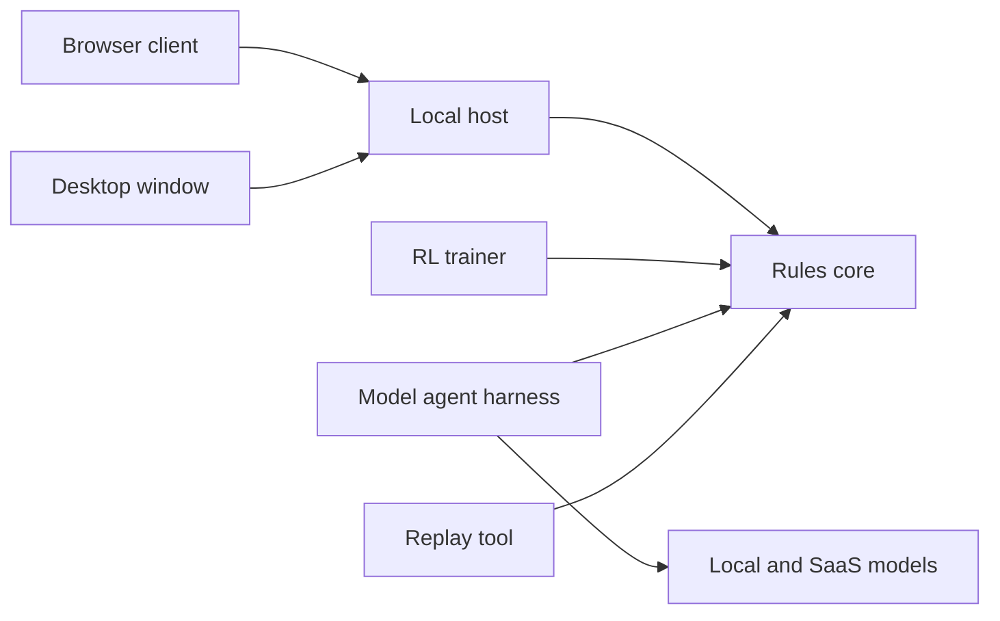

# Squad_Leader_AI

An edition of the 1977 Avalon Hill board game Squad Leader, with the 4th edition rules. It has a rules engine that shows the rule number for each result, and computer opponents that learn. It plays in a browser or in a window of its own on Windows and on Unix.

This project is not affiliated with, sponsored by, or endorsed by Hasbro or Multi-Man Publishing. It ships no Avalon Hill art, scans, board layouts, or rulebook text. The game gets a different public title before a release. The repository name is a working name.

## What it looks like


The desktop window in turn 4 of the armor scenario. The panel gives the turn, the phase,
the legal command list, and the action log with the rule ID of each result.

Three boards from the generator, drawn by the same code:

| A village | A city | Hills |
|---|---|---|
|  |  |  |

Each terrain is a shape on the ground and not a hexagon of colour. A wood is a mass of
crowns. A building is the plan of a structure that can cover more than one hex. A road is a
ribbon that turns. A hill is a flat brown area with a crest line where the level changes.

`tools/make_docs_images.py` makes these pictures from the generator and the window code.
`docs/images/MANIFEST.json` gives the seed of each one, the release audit reads that
manifest, and `tests/docs/test_documentation_images.py` makes each picture again and
compares it. So each picture in this repository is the output of the code in it. A scan
that gets into that directory stops a test, and the audit reports it (SR-07).

## What it is

One rules core with no input or output plays rules 1 to 44 of the 4th edition text. That is the infantry game, the armor game, hills, hidden placement, and the rural terrain. The core keeps the rule ID of each rule it applies. The action log shows the rule, the dice, and the modifiers for each result, for the two sides. A local host owns each game and gives each player only that player's view, so concealment works in the browser. The boards come from a generator in the 1977 look, and the counters are new art from the 1977 values.

Four play modes: two humans at one screen, or two clients on one LAN with a room code. Also a human against a computer opponent, and two computer opponents in a headless tournament. A client is a browser or the desktop window.

Four families of computer opponent, behind one interface:

- scripted agents with named parameters
- learned agents, neural networks from self-play reinforcement learning
- prompted model agents, local or SaaS language models that select from the legal command list
- tuned model agents, local language models fine-tuned on the game's own traces

## How it works



The core gets a state and a command and gives a new state, the events with their rule IDs, and a hash. A game is its seed, its switches, and its command log. A replay reproduces the hash sequence or it is a defect.

## Hardware and runtime

| Component | Target |
|---|---|
| Owner workstation | Windows 11, one NVIDIA GPU. Linux also supported. |
| Core, host, trainer, harness | Python 3.12 or a subsequent version |
| Client | TypeScript, Vite, a browser. Also a desktop window with pygame-ce, on Windows and on Unix |
| Local models | An OpenAI-compatible server (llama-server, Ollama, vLLM, LM Studio) on the LAN |
| SaaS models | Anthropic in year one. OpenAI, Gemini, xAI, Mistral at the release candidate |
| Training | PPO in raw torch on one GPU. A LoRA fine-tune of a 7B to 14B model on one GPU |

## Quick start (development)

The commands:

```
python -m venv .venv
.venv/Scripts/activate
python -m pip install -e ".[dev]"
python -m pytest tests/

# For the trainer, which needs torch:
python -m pip install -e ".[train]"

# For the desktop window, which needs a 2D game library:
python -m pip install -e ".[desktop]"
```

Then play, measure, and compare:

```
sl-cli play --scenario s01_guards_counterattack --games 3 --verify
sl-cli gate --scenario s01_guards_counterattack --games 100
sl-cli bench --scenario s01_guards_counterattack --workers 1,8,16 --minutes 10 --out runs/bench/stats.json
sl-cli tournament --agent-a v1 --agent-b v0 --games 20
sl-cli runs --rebuild
sl-cli boards --count 1000
sl-cli boards --write runs/boards --count 12
sl-cli agents --list
sl-cli agents --games 100
sl-cli train --steps 100000 --eval-games 50 --tensorboard runs/tb
sl-cli window --scenario s04_armor_probe --agents v1,v2
```

`sl-cli window` opens a window of its own with no browser. With no address it starts a
host in the same process. It then connects to that host on the loopback address, which is
the path the browser client takes. `--connect ws://host:port/ --room-code CODE` connects to
a host that operates at this time.

In the window: a click picks a hex. The arrow keys and the wheel move the board and change
its dimension. `f` fits the board in the window, `s` writes a picture, and `q` stops.

`python tools/make_docs_images.py` makes the pictures that this file shows. Run it after a
change to the board drawing. The test in `tests/docs/` compares what the tool makes with
what the tree holds.

`sl-cli boards --count 1000` is the board gate. It makes the boards, checks the geomorphic edges, connects each board to the next, sets scenario 1 up on it, and writes a run artifact. `--write` puts the board documents in a directory for the owner's scoring session.

A run artifact goes in `runs/<ISO8601-Z>-<slug>/` with a manifest, the command log, the action log, and the statistics. `runs/runs.sqlite` indexes them. Git does not record the run directory or the index.

API keys for SaaS providers go in `claude.key.txt`, `openai.key.txt`, `gemini.key.txt`, `mistral.key.txt`, and `xai.key.txt` at the project root. `.gitignore` lists them on its first line. A missing key marks that provider unavailable and stops nothing else.

## Status

| Item | State on 2026-09-08 |
|---|---|
| Research report with eight appendices | Done |
| Vision, Requirements, Success Criteria | Done, after two multi-AI reviews |
| Architecture | Done, v0.2, after the second multi-AI review |
| Code | Slices 1 to 6: rules 1 to 21, scenario 1, the conformance corpus, replay, run artifacts, the tournament, the host, the browser client, and the board generator |
| v0.1 headless rules proof | Complete. A run artifact records each of the gates TC-01, TC-02, TC-04, TC-05, TC-08, TC-09, TC-10, and TC-38 |
| Throughput | 5,662 environment steps/s at 16 workers on the complete scenario 1, against a gate of 3,500 |
| v0.2 browser hot seat | The host, the client, and the browser test are done. BC-01 waits for the owner to play one game |
| Board generator | Five passes and four board types: city, hills, village, rural. Each type has a style record. TC-14a holds on 1,000 seeds. Generated mode plays scenario 1 with zone set up areas |
| Hills | Rule 43: three levels, crest lines, the height advantage, and the blind hexes. The client draws the hill shades and the crest lines |
| Release audit | `python tools/audit_release.py` reads the tree, the built page, and the run artifacts for TC-25, TC-28, and TC-29. It reports zero findings |
| Model agents | Five SaaS providers and one local endpoint, with one adapter for each of the three API shapes |
| Rules 22 to 27 | Flamethrowers, demolition charges, smoke, concealment, fanaticism, and sewer movement, with scenarios 2 and 3A |
| Armies | German, Russian, and American counters, with the values of RV-1. A side can field two armies, and one project scenario starts with all three |
| Boards side by side | FR-29: two to four generated boards make one playing surface, along the long edges or the short edges, with a turn of 180 degrees |
| Computer against computer | `sl-cli host --agents v1,v2` plays a game by itself, and a browser shows it. The browser harness plays a full game and checks the client, the rules, and the agents |
| Armor game, the vehicle | Rule 28 to rule 32. The printed values, the covered arc, the movement chart, passengers, and the hull as cover |
| Armor game, the fight | Rule 33 to rule 41. The to-hit table, the kill table, overruns, infantry against armour, the panzerfaust, the bazooka, malfunctions, immobilization, and wrecks |
| Armor scenario | `s04_armor_probe` is the first game that plays rules 28 to 41 |
| Desktop window | `sl-cli window` opens a window of its own on Windows and on Unix, with no browser. It shows the buildings, the trees, the walls, the hedges, the cliffs, the roads, the hills, the wheat, and the shellholes. It also shows a vehicle with its covered arc |
| Terrain drawing | Each terrain is a shape on the ground and not a coloured hexagon. The style is flat shading: a lit face, a body, a shaded face, and a line. The window and the browser hold one set of colours, and a test compares the two files |
| Rural terrain | Rule 44: a wheatfield that stops sight through it, a seasonal crop, the shellhole modifier, and cliff hexsides on a hill |
| Hidden placement | Rule 42: a side the scenario names records a unit in a woods hex or a building hex, and the other player sees nothing of it |
| Design your own | Game Set IV: a force point scale, random scenario construction from a seed, and the campaign game. A personal leader holds a rank, and the rank follows the record |
| Agents | Four scripted agents with named parameters, and a learned agent with PPO, a league, and an Elo table. Agent v3, the tanker, is the one that plays rules 28 to 41 |

What works: `sl-cli play --scenario s01_guards_counterattack` plays scenario 1 headless with two scripted agents and replays it. `sl-cli tournament` plays N games with the sides balanced and writes a run artifact. `sl-cli bench` measures the environment step rate. `sl-cli boards` makes boards and checks them.

`sl-cli boards --write <directory> --count 12` writes three boards of each type and the empty score sheet of TC-14b. `python tools/audit_release.py` runs the release audit.

`sl-cli host --agents v1,v2 --agent-delay 0.3 --open-browser` plays a game between two computer opponents and opens a browser that shows it. `sl-cli window --agents v1,v2` does the same in a window of its own, with no browser.

`sl-cli campaign --draw 12` writes twelve random scenarios and plays none of them. `sl-cli campaign --seed 11 --scenarios 6` plays a campaign and writes the personnel file of each scenario. A scenario name of the form `random:500` is a scenario that the seed 500 builds, so `sl-cli play --scenario random:500` plays it.

What is decided: see `VIBE_HISTORY.md`.

The printed board layouts are not in this repository. Generated mode makes a board from a seed and resolves the set up areas of a scenario by zone. Reference mode reads a layout from `background/reference/` on the owner's machine, and git does not record that directory.

## Companion documents

- `docs/VISION.md`: direction, the five bets, the three-year arc
- `docs/REQUIREMENTS.md`: the requirements with IDs and tiers
- `docs/SUCCESS_CRITERIA.md`: the measurable gates and the test plan
- `docs/ARCHITECTURE.md`: the design with the cause of each decision
- `docs/2026-09-07_Squad_Leader_Digital_Edition_Research.md`: the evidence, with the eight appendices in `docs/research/`
- `tasks/todo.md`: the slice plan
- `tasks/lessons.md`: corrections and surprises
- `VIBE_HISTORY.md`: the session log, newest first
- `CLAUDE.md`: the operating manual for Claude Code sessions

## License

GPL-3.0-or-later. See `LICENSE`. The rules of the game are a method of play and are not copyrightable. The rules text, the board art, and the counter art of the 1977 game are Hasbro's, and this project reproduces none of them.
