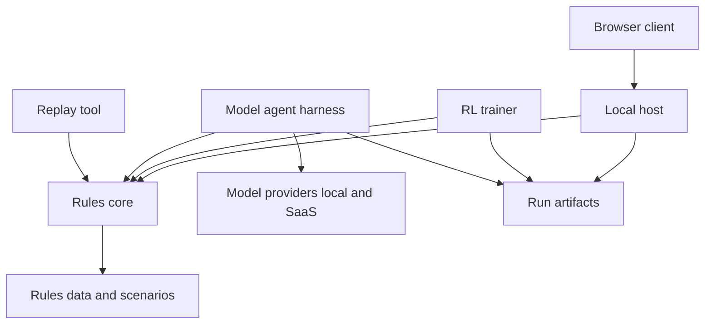
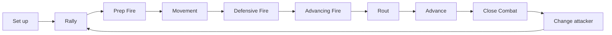
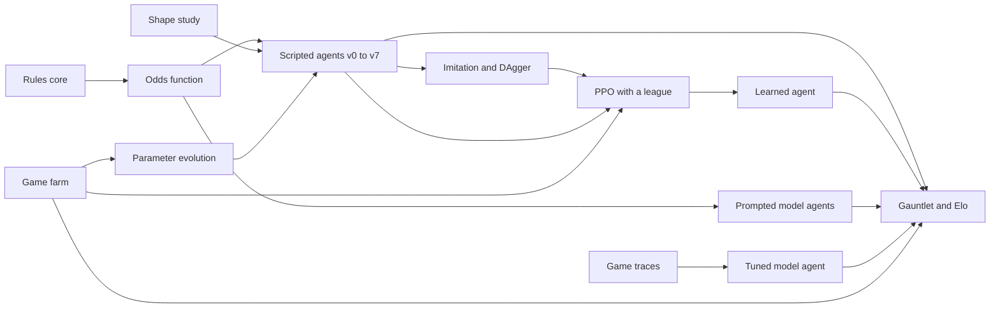
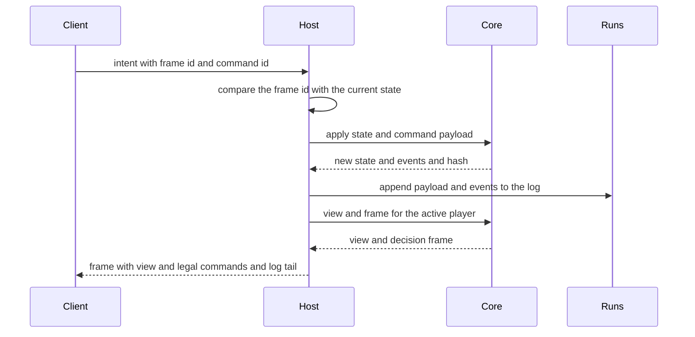

# Squad_Leader_AI: Architecture

Author: Ron Dilley, with design work by Claude Fable 5.1
Date: 2026-09-07, updated 2026-10-15
Status: v0.3, the design of the tree as built. Section 9.5 gives the methods of the computer players (2026-10-15)
Companion documents: `VISION.md` (direction), `REQUIREMENTS.md` (the requirements with IDs), `SUCCESS_CRITERIA.md` (the gates), `2026-09-07_Squad_Leader_Digital_Edition_Research.md` (the evidence), `../tasks/todo.md` (the build slices)

<!-- AI review 20260907-163721 (gemini, xai, openai). The changes: the decision frame, the exact lattice, the two-part LOS, and the command list for rules 1 to 21. Also the sub-step table, the SR-10 control, the throughput gate after slice 3, and Appendix B. Each changed section has its own note. -->

This document explains the cause of each design decision. The research did the work of finding what the field settled and where it did not. This document selects answers in those open spaces and constrains the build. If you are about to write code, read this first.

Each section states one decision, the alternative, the cause, where the decision breaks, and the mitigation. Mermaid diagrams support the prose. They do not replace it.

## 1. The shape of the system

Five consumers use the rules engine, and no human is in most of them. That is what makes this system different from a generic digital board game.

A browser client shows a human a view. A local host owns the game and applies commands. A trainer plays millions of headless games. A model agent harness turns a game view into text and a text answer into a command. A replay tool runs a command log again and compares hashes.

Each consumer would drift from the others if it had its own copy of a rule. So there is one core, and each consumer applies a rule only through it.

The second thing that shapes the system is that the core must be fast for reinforcement learning on one workstation. That sets the language decision, the geometry decision, and the throughput gate. The third thing is that the game has hidden information. So the host must give each player a different view, and the client must not hold the full state.



The core is a Python package with no input, no output, no network, and no file access. It gets a state and a command. It gives a new state, a list of events, and a hash. It also gives the legal command list for a state, as a decision frame (section 3.4).

The host, the trainer, the harness, and the replay tool are Python packages that import the core. The client is TypeScript in the browser, and it communicates with the host on a WebSocket. The providers are HTTP endpoints.

## 2. One core with no input or output

The decision: the rules live in one Python package, `slcore`, that has no side effects. It does not read files, roll dice from the system clock, open sockets, or print. It has three public functions: `legal_commands(state)`, `apply(state, command)`, and `hash_state(state)`.

The alternative: a rules engine in the browser (boardgame.io or a TypeScript port) and a second engine in Python for training. The research rejected this (RV-3 section 4.3). Two engines drift. Also, boardgame.io keeps its state and random generator in JavaScript, so Python cannot share them.

Why this is right, first cause: each consumer gets the same rule, the same dice, and the same hash. The conformance corpus (TR-01) runs one time against one package, and each consumer inherits the result. Second cause: a package with no side effects is the only thing that ports to Rust with a bounded test. The port is a new package with the same three functions and the same corpus (AR-05).

Where it breaks: CPython is 10 to 200 times slower than compiled code on compute-bound work (RV-7 section 1.3). The trainer must have 3,500 environment steps/s (NFR-01).

Mitigation: the throughput gate is measured at the end of slice 3, on the complete scenario 1, before the rules for the subsequent scenarios are written. The design below keeps the per-step work small: a cached LOS table, integer arithmetic, and a legal-command list built from a small set of candidate units. If the gate is not satisfied, the core moves to Rust with PyO3 and wasm-bindgen bindings as its own milestone (section 14).

## 3. The command model and the phase state machine

The decision: the unit of play is a command. A command is one player intent: an action, the units it applies to, and a target, or an end-phase marker. The core gives the full legal command list for the active player in the current phase and sub-step.

The active player selects one. The core applies it and gives events. Dice results are events, not commands.

This is the load-bearing design of the project. The three reviewers of the first pass and the three reviewers of the second pass converged on it: legal-command generation is the critical path. The mask for the trainer, the list for the model agents, and the click targets for the client are the same list.

The internal shape of the list is a tree: action, then unit or units, then target. The trainer's composed action head walks that tree (section 9.2). The client and the model agents get the flat enumeration of the tree from the decision frame (section 3.4). The flat sequence is a view of the tree, and nothing stores a position in it.

<!-- AI review 20260907-163721: gemini, the hierarchical command tree -->

### 3.1 What one command is, phase by phase

<!-- AI review 20260907-163721: gemini and openai, portage. openai, set up, the two-player windows, predesignation, the track return, and the close combat allocation. -->

The list below covers rules 1 to 27, which is scenario 1 (v0.1) and scenarios 2 and 3A (v0.3). Commands for the rules that are not in scope are named where they land, with their tier.

- Set Up Phase (rule 21.2): `place(unit, hex)` for each unit in the side's set up area, in the sequence the scenario gives. `place_weapon(weapon, unit)` gives a support weapon to a unit in the same hex. `end_setup`. The scenario file says which side sets up first.
- Rally Phase (rule 4.1): the two players have a command window. The phasing player goes first, then the defender. This sequence is a project ruling, because rule 4.1 gives no sequence. It is recorded in the project rulings data (section 6).
- Rally Phase commands: `repair(weapon)` (rule 18.2), `rally(unit)` (rule 14.1), `end_phase`. The dice results are events. The core removes DM counters (rule 14.6) as an automatic step.
- Prep Fire Phase (rule 4.2): fire is a short sequence of commands. `group_add(unit, target_hex)` adds a unit to the fire group that aims at a target hex. `group_add_weapon(unit, weapon, target_hex)` adds a support weapon. `group_leader(leader)` adds or removes the leader modifier for the group, because the Q and A for rule 15.1 gives the player that choice for fire groups.
- Prep Fire Phase, resolution: `group_fire()` resolves the group on the Infantry Fire Table and emits the events. `end_phase` closes the phase. A fire group is open only while its members are in the same or adjacent hexes (rule 8.6). Smoke placement (rule 24.3) is a v0.3 command.
- Predesignation (rule 8.7): the scenario switch selects the method. With the basic method, `group_fire()` resolves one group and the player then forms the next group. With the optional method, the player forms each group with `group_add` and closes each with `group_close()`. Then `fire_all()` resolves each group in sequence, and no new group is legal after it.
- Movement Phase (rule 4.3): `move(unit, hex)` moves one hex and spends movement factors. `stack_move(leader, units, hex)` moves a leader with squads for the leader bonus (rule 5.44). `end_phase` closes the phase.
- Movement Phase, portage: `pickup(unit, weapon)` and `drop(unit, weapon)` are legal at each point of a move, with the portage cost of the Support Weapons Chart (rules 5.7 to 5.72). The core records the track of each moved unit: the sequence of hexes where it spent movement factors (rule 16.4).
- Movement Phase, rules 23 and 27: `place_demo(unit, weapon, hex)` puts a demolition charge on a hex next to the unit (rule 23.3). `sewer_move(units, entrance)` moves a stack down one sewer entrance and up at a second one in three hexes (rule 27.2). `sewer_return(hex)` is the window of the opposing player for a stack that was lost (rule 27.22). `board(unit, vehicle)` waits for the armor rules.
- Prep Fire Phase, rule 24: `place_smoke(unit, hex)` puts one smoke counter in or next to the hex of an assault engineer squad, as the first action of the phase (rule 24.3).
- Fire phases, rule 22: `ft_fire(unit, weapon, target_hex)` is one flamethrower attack. It is its own command and not a fire group, because rule 22.3 says a flamethrower does not fire with other units.
- Advancing Fire Phase, rule 23: `explode_demo(charge)` explodes one operable charge when the owner selects it (rule 23.4).
- Set Up Phase, rule 25.6: `place_concealment(hex)` puts one of the counters the scenario gives on a woods hex or a building hex of the side's set up area.
- Defensive Fire Phase (rule 4.4): the defender is active. `track_return(units, hex)` moves a set of units that moved through the target hex back to that hex on their track (rules 16.1 and 16.3). Then the fire commands apply, and the target hex is the return hex.
- Defensive Fire Phase, after each group: the core moves the units that did not break to their end position, or to the next track hex the defender names. Units that did not move are targets where they stand (rule 16.2). `end_phase`. The core removes the track records as an automatic step.
- Advancing Fire Phase (rule 4.5): the same fire commands. The core applies the moved-fire halving (rule 9.3) and the portage limit on support weapon fire (rule 5.74). The core removes the Prep Fire counters as an automatic step.
- Rout Phase (rule 4.6): the two players have a command window, the phasing player first, as rule 4.6 says. `rout(unit, hex)` for each hex of the rout path, with the legal destinations from rules 13.4 to 13.47. `stay(unit)` for a broken unit in cover and not adjacent to an enemy. `end_phase`. The core removes a broken unit with no legal path (rule 13.47), and the event names the rule.
- Advance Phase (rule 4.7): `advance(unit, hex)` one hex, with the portage limit of rule 5.73. `end_phase`.
- Close Combat Phase (rule 4.8): the two players have a declaration window, the phasing player first, then the defender. `cc_attack(attacking_units, defending_units, leader)` declares one attack. Each unit attacks one time in the phase (rule 20.4). The leader modifier applies to one declared attack for each leader (rule 20.6). `end_phase` closes the window.
- Close Combat Phase, resolution: when the two windows close, the core resolves each attack in the declared sequence, and the effects apply at the same time (rule 20.2). The declaration sequence between the players is a project ruling.

The alternative: a free-form action description that the engine parses. That is what makes language model agents give invalid moves (RV-6 section 1.5). With a closed list, a model agent selects an ID, and an invalid answer is not possible by construction.

Where it breaks: the list can be long. In a Movement Phase with 20 units and 6 neighbors each, the list has 120 move commands plus the pickup, drop, and end-phase commands. That is not a problem for a model agent, because each command is about 12 tokens (RV-6 section 7). It is not a problem for a trainer with a composed action head (RV-5 section 2). It is a problem if the core builds LOS or paths again for each candidate.

Mitigation: the LOS table is cached (section 5). Movement candidates come from the six neighbors and the movement factors that remain. The list for a sub-step is built one time and used again until a command changes the state.

### 3.2 The state machine

The phases follow the "Advanced Sequence of Play" on page 41 of the rules. Each phase has a numbered list of sub-steps with rule pointers, and the core runs them in that sequence. Some sub-steps are automatic. Some open a command window. The core records the phase, the sub-step, and the active player in the state, and the three are part of the hash.



The sub-step table below is the state machine for year one, in the project's own words. Each row names the rule that the sub-step applies. Rows for the armor rules, artillery, night, wire, and fire (Game Sets II and III) are not in the table, and the core adds them with those rules. <!-- AI review 20260907-163721: xai and openai, the sub-step table -->

| Phase | Sub-step | Kind | Rule | Tier |
|---|---|---|---|---|
| Rally | Repair malfunctioning support weapons | Window, phasing player then defender | 18.2 | v0.1 |
| Rally | Rally broken units | Window, same | 14.1 | v0.1 |
| Rally | Remove DM counters | Automatic | 14.6 | v0.1 |
| Prep Fire | Remove the smoke of the phasing player | Automatic | 24.8 | v0.3 |
| Prep Fire | Put new smoke | Window with a condition, phasing player | 24.3 | v0.3 |
| Prep Fire | Fire at enemy units | Window, phasing player | 4.2, 8 to 11 | v0.1 |
| Prep Fire | Place Prep Fire counters | Automatic | 4.2 | v0.1 |
| Movement | Bring a sewer stack up from the sewer | Window with a condition, defender | 27.22 | v0.3 |
| Movement | Move units that did not prep fire, place charges, go down a sewer | Window, phasing player | 4.3, 5, 6, 23.3, 27.2 | v0.1, v0.3 |
| Movement | Concealment for sewer movers with no enemy near | Automatic | 27.5 | v0.3 |
| Defensive Fire | Fire at enemy units, with track returns | Window, defender | 16.1 to 16.5 | v0.1 |
| Defensive Fire | Say which demolition charges are operable | Automatic | 23.3 | v0.3 |
| Defensive Fire | Remove track records | Automatic | 16.3 | v0.1 |
| Defensive Fire | Remove concealment next to unbroken enemies | Automatic | 25.4 | v0.3 |
| Advancing Fire | Explode the demolition charges that are operable | Window with a condition, phasing player | 23.4 | v0.3 |
| Advancing Fire | Fire moved units at half firepower | Window, phasing player | 4.5, 9.3 | v0.1 |
| Advancing Fire | Remove Prep Fire counters | Automatic | 4.5 | v0.1 |
| Rout | Broken units rout to cover | Window, phasing player then defender | 4.6, 13.4 | v0.1 |
| Advance | Move unbroken infantry one hex | Window, phasing player | 4.7, 5.73 | v0.1 |
| Advance | Remove concealment next to unbroken enemies | Automatic | 25.4 | v0.3 |
| Close Combat | Declare attacks | Window, phasing player then defender | 20.4, 20.6 | v0.1 |
| Close Combat | Resolve attacks | Automatic | 20.2, 20.3 | v0.1 |
| Close Combat | Concealment on units that did not fire and did not move | Automatic | 25.3 | v0.3 |
| End of turn | Change the attacker, move the turn record forward | Automatic | 4.9 | v0.1 |

Two properties of the table need a word.

A window with a condition opens only when its rule has a decision for that player. Smoke, a demolition charge, and a stack in the sewer are rare. A window that is always open puts an empty decision in each player turn. The condition is part of the state machine, so the core and a replay agree on which windows a game had.

The removal of a concealment counter by rule 25.4 is not a sub-step when a unit moves or fires. Rule 25.4 says immediately, so the counter comes off in that command. The sub-steps above are the second half of that rule. A counter comes off at the end of the Defensive Fire Phase and the Advance Phase when an unbroken enemy is next to it. Rule 25.5 is the cause of the delay: the counter stays when Defensive Fire eliminated or broke that enemy.

The optional rules are switches in the scenario (FR-08). The switch values are in the hash, so a replay with incorrect switches stops at the first command.

Optional rule 16 is a sub-state of the Movement Phase. After each moved stack ends its move, the defender gets a fire window against that stack. The Defensive Fire Phase then has no track returns. The basic method of rule 4.4 and rule 16.1 is a phase after movement with track returns, and the core has the basic method as its default.

<!-- AI review 20260907-163721: gemini said the basic method misrepresents the rules. It does not. Rule 4.4 and rule 16.1 give the basic method as a phase after movement, and optional rule 16 is the interleaved method. -->

### 3.3 Rule IDs in code

Each rule is a function or a data row with the rule ID in its name and in its docstring, for example `rule_9_1_point_blank(...)`. Each event that the core emits has the rule IDs that produced it. The action log (FR-06) is the event list with the dice and the modifiers. A player reads "KIA, rule 10.6, IFT column 16, roll 4, modifiers +3 stone building (11.1), -2 leader (15.2)" and finds each number in the rulebook. This is the community signal from RV-8 as a data structure.

### 3.4 The decision frame and the command identity

<!-- AI review 20260907-163721: gemini and openai. A command ID as a list index cannot serve replay, traces, and training. -->

The decision: the core gives the legal commands as a decision frame. A frame has the frame ID, the active player, the phase and sub-step, and the list of legal commands. Each legal command has a canonical payload and a command ID. The payload is a small record: the action name, the unit IDs in sorted sequence, the target hex, the weapon ID, and the other fields of that action.

The command ID is the first 64 bits of the SHA-256 hash of the payload in its canonical byte form (JSON with sorted keys and no white space). The frame ID is the state hash of the state that the frame was built from.

Unit IDs are stable for the game. Each counter gets its ID from its position in the scenario force list, not from a list position at run time. Hex IDs are the grid labels (for example `K5`) with a board prefix in a composition (section 7).

The command log stores the payload (DR-04). A replay reads each payload, builds the frame for the current state, and finds the command by ID. The trace record stores the payload, the ID, and the legal IDs (DR-08). The trainer's mask maps each head choice to a payload and then to an ID. The client sends the frame ID and the command ID (section 8). No consumer stores a position in the flat list.

The alternative: the command ID is an index into the legal list the host sent, as the v0.1 design said. That is one integer, and it is cheap. It breaks when the list sequence changes.

A code change can sort the list in a different sequence. A Rust port can iterate in a different sequence, and a new candidate rule can add an entry. Each of these puts the stored index on a different command, so the replay, the traces, and the mask do not agree with the log.

Why this is right, first cause: the payload names what the player did in game terms, so it is stable across list sequences, code versions, and languages. Second cause: the ID is short, so a model agent selects a short token, and the harness maps it back to the payload. Third cause: the host, the trainer, the harness, the trace writer, and the replay tool use the same frame, so there is one artifact to test (TC-38).

Where it breaks: a canonical form must be the same in Python, in Rust, and in the browser. SHA-256 is available in the three, and a sorted-key JSON encoder with no white space is a small function. The client does not calculate IDs. It receives them from the host, so the client needs no encoder.

Mitigation: a golden test holds ten payloads with their IDs. The Rust port runs the same test. TC-38 shuffles the legal list and replays a game, and the hash sequence must agree.

## 4. State, views, and secrecy

The decision: the host keeps one authoritative state. For each outbound message the host calculates a view for one player. A view holds the player's own units in full, the opponent's units that the rules let the player see, and opaque tokens for concealed stacks.

The client, the model agent harness, and the trace writer see views only. The host calculates the state hash. The client sends intents only.

The alternative: send the full state to each client and hide units in the client. The first multi-AI review named the problem: a player reads the network messages or the browser memory (consolidated review, security 1).

Why this is right, first cause: concealment is a rule, not a display setting. Rule 25.2 says a concealed stack "must be treated as if it were an opposing squad until proven otherwise". Only a view can enforce that.

Second cause: the prompt to a model agent and the trace for the tuned model must not leak the opponent's hidden units. If they do, the model gets training data it must not have (SR-09, SR-10).

How a view works, as slice 7 built it: each concealment counter has its own identity, and no second counter of a game has it. The owner's view carries the counter, the units below it, and the units themselves. The opponent's view carries the counter, its hex, and how many counters are in that hex, and no unit of that hex at all.

The identity is the same number for the two players, and that is not a disclosure. A counter is a piece on the board that the two players see and follow from turn to turn, which is what the number does. The number does not hold what is below the counter.

Dummy stacks (rule 25.7) are counters with no units below them, and the opponent's view cannot tell them apart. The test for that is simple: the token of a dummy and the token of a full stack have the same fields and the same values. Hidden Initial Placement (rule 42, Scale) is the same mechanism with no counter shown at all.

The cost of a view has three cases. When no unit is concealed, the view is a copy of the unit list with the viewer's side identified. Its cost is linear in the unit count. Scenario 1 has no concealment, so the trainer in v0.1 pays this case only. When some stacks are concealed, the view replaces each concealed stack with its token. The cost is linear in the unit count plus the token map.

When the scenario has hidden placement, the view drops the hidden units and the cost is the same as the second case. The benchmark of NFR-01 includes the view build, so TC-09 measures the cost. The core does not keep a view between calls, because the core has no state of its own. The host keeps the last legal list of each seat and the last spectator view. It uses them again until a command changes the state.

The host message is that view for one seat. An unjoined socket gets no frame. In a LAN room the legal list goes to the seat that acts. The idle seat gets an empty list. Hot seat keeps the list.

The log tail omits a line that names a unit the viewer cannot see. A hidden unit is not in the other player's view. Each viewer has its own log stream, and `seq` counts the lines of that stream with no gap. Hot seat reads the stream of the side on the screen. So a side does not keep the lines of the other side in its history.

<!-- AI review 20260907-163721: xai, the view cost model -->

Where it breaks: a view for each outbound message costs time in the trainer, which plays millions of games with no hidden information problem in self-play.

Mitigation: the trainer uses the view function too, because the policy must learn from what a player can see. Hot seat play on one screen cannot stop the local user from a look at the other player's turn. The host gives one view at a time, so the client does not hold the two.

## 5. Determinism, geometry, and line of sight

<!-- AI review 20260907-163721: gemini and openai. The 1,000 by 866 lattice was an approximation with an assertion. The cache stored one byte for an unordered pair, and FR-28 said ordered pairs. -->

The decision has four parts. One seeded random generator lives in the core. The command log with a hash after each command is the game. All rules arithmetic is integer. The hex geometry lives on an exact integer lattice, and line of sight is a segment-against-polygon test with integer cross products. The static part of the test is cached for each board, and a rule evaluator applies the context at play time.

The alternative for dice: the host or the client rolls. Then a replay cannot reproduce the game, and a trainer cannot reproduce a defect.

The alternative for geometry: float coordinates with a hex-cell algorithm (Red Blob, RV-3 section 5.1). The first multi-AI review found that float geometry and an integer-only rule (NFR-05) do not agree, and proposed floats in the LOS function. The project rejected that. It cannot prove that a Python float path and a future Rust or WebAssembly path agree bit for bit.

The second alternative, from the second review: cube coordinates, which give the hexes that a line between two centers goes through. Not used. Rule 7.1 tests a thread against the terrain shapes printed in the hexes, and cube coordinates have no sub-hex shapes. A building that fills half of a hex stops some threads through that hex and not others.

Why the lattice is right: the board rule is a thread from center dot to center dot that touches printed terrain (rule 7.1). VASL reproduces this with a per-pixel raster walk (RV-3 section 5.2). A vector version gives the same answer with less data. Each hex holds terrain polygons, and the LOS test asks if the segment goes through a polygon that blocks.

The lattice is exact. A hex with a side of 2 units has its center and its six vertices at lattice points. At a lattice point, x is an integer, and y is an integer multiple of the square root of three. The core stores y as that integer and does not multiply it out. A cross product of two such vectors is an integer times the square root of three, so its sign is exact. A dot product and a squared distance are integers.

The segment tests use cross products only, so the LOS test has no rounding and no platform dependence. A finer polygon scale multiplies the two coordinates by the same integer.

The v0.1 design scaled the hex height to 866 units as an approximation. The defect was not distance, which the lattice does not measure. The defect was that a scaled integer y can put a thread on the incorrect side of a polygon vertex. The exact lattice removes that. The conformance corpus stays the arbiter. Each LOS example in the rulebook (rules 7.4, 7.7, 17.5, the LOS course on page 30) becomes a case.

Why the cache is right, and what it holds: a board has 346 hexes with its half hexes, so 59,685 unordered pairs. At board load the core calculates the thread for each pair: the sequence of hexes the segment goes through, the static result (clear or blocked by terrain), and the hexes with a hindrance-capable terrain (wheat). A segment along a hexside gets two threads, one for each side, because rule 17.7 gives the firer the choice. The static table is symmetric, so it is unordered (FR-28).

The rule evaluator runs at play time with the firer as the context. It gets the static thread and applies the firer's hexside choice. It adds the dynamic hindrances (smoke, vehicles, fire), and it walks the thread in the firer's direction for machine gun penetration (rule 17). So a LOS question is one table lookup plus a walk along a short list. This is the largest single lever on the throughput gate.

What the first measurement showed: the static thread table is necessary and not sufficient. The rule evaluator on top of it ran for each pair on each frame, and it costs more than the table lookup. The core memoizes the evaluator result for a pair while no smoke and no vehicle is on the board, which is each state of v0.1. The lesson file records the profile and the three other costs it found.

The random generator: the core uses xoshiro128** with a 32-bit state. It has a CC0 reference in C, a direct port in Python with a 32-bit mask, and a direct port in JavaScript with `Math.imul` (RV-7 section 5.2). If the core moves to Rust, the same generator moves with it. A golden-vector test (one seed, the first 1,000 outputs) proves agreement across languages.

Where it breaks: an exact lattice can put a segment through a polygon vertex or along a polygon edge. The result is then a policy, not an accident, and the rules have an answer for the two cases.

Rule 43 gives each hex a height, and the core applies the rule as one integer test. The height of the thread above a hex is a linear interpolation between the two ends. The test compares that height with the top of the hex.

A hex with a symbol that stops the sight stops the thread when its top reaches the thread. That is the height advantage of rule 43.4. A bare hill hex stops the thread only when its level is above the thread, which is rule 43.7. The blind hexes of rules 43.6 and 43.62 come from the end with the height advantage. That keeps rule 43.8: when A sees B, B sees A.

`r43_elevation.py` holds this reading. It says nothing when each hex of the thread is on ground level, so the city boards keep one reading of rule 7.

Rule 7.1 says the LOS is blocked when the obstacle shows on the two sides of the string. So a thread that only touches a polygon vertex, or runs along a polygon edge, is not blocked. Rule 17.7 says a LOS along a hexside goes through one of the two hexes at the firer's choice. The core encodes the two as the tie break (slice 1, `tests/los/`). Rule 43 (hills and blind hexes, Scale) adds elevation to the polygon test on the same lattice.

## 6. Rules as data

The decision: the tables, the counters, the scenarios, and the boards are data files in the project's own layout. The Q and A rulings are data with the rule number they refer to. The conformance corpus is JSON. The rule functions are the only code, and each one reads its numbers from the data.

The project's own rulings are a second data file, apart from the official rulings. A project ruling fills a gap that the rules text leaves open, names the rule it extends, and says the cause. The first two are the Rally Phase sequence and the Close Combat declaration sequence between the players (section 3.1). <!-- AI review 20260907-163721: the referee found the Rally Phase gap -->

The alternative: numbers in code. That makes a gamette overlay (Cross of Iron, vNext) a code rewrite, and it hides the provenance of each number.

Why this is right, first cause: the legal analysis (RV-4 section 3) says tables are a method of operation and are safe to reproduce. It says to reproduce them as your own data in your own layout. A data file with a provenance note is that layout. An example note: "IFT, from the data card image, RV-1 section 7.1, compared against the rulebook example in 10.6".

Second cause: the conformance corpus cites the rule text for each case. A case that names a data row and a rule function is a case a future session can audit.

The victory evaluator (FR-14) is a rule function with a data contract. A scenario file lists its victory conditions as typed records: control of named buildings or zones, units exited from an edge, casualties as a fraction, and a turn limit. The core tests the conditions at the end of the last player turn, and it tests a sudden-death condition at the end of each phase. The result is an event with the winner or a draw, and one line for each condition with its count and its threshold. The action log shows that event as the cause of the result.

<!-- AI review 20260907-163721: openai, the victory evaluator contract -->

The rule-by-scenario matrix, from the "Rules Introduced" line of each card (RV-2 section 3):

| Scenario | Rules | Tables | Counter types | Tier |
|---|---|---|---|---|
| 1, The Guards Counterattack | 1 to 21 | IFT, Close Combat, Support Weapons, movement costs, terrain modifiers | squads, leaders, LMG, MMG, HMG, markers | v0.1 |
| 2, The Tractor Works | 22 to 26 added | the same, plus flamethrower and demolition charge rows, smoke | plus flamethrower, demolition charge, smoke, concealment | v0.3 |
| 3A, The Streets of Stalingrad with sewers | 27 added | the same, plus the sewer roll | plus the sewer entrance flags | v0.3 |
| 3B, with armor | 28 to 41 added | To Hit, AFV Kill, hit modifiers, vehicle movement, immobilize numbers | vehicles, crews, wrecks, malfunction markers | Scale, after the armor tables are sourced |

Where it breaks: the armor tables are not sourced (RV-1 section 7.6).

Mitigation: the data format has rows for them, and the rule functions for 28 to 41 wait. A scenario file lists its rule IDs (FR-19). The core refuses a scenario that uses a rule that is not in the build, with a message that names the rule.

## 7. Boards, the generator, and the two modes

The decision: a board is a data structure of 33 by 10 hexes with half hexes on all four edges (FR-23). Each hex holds terrain type, elevation, building type and dimension, hexside features, and the flags for sewers and stairs (DR-03). Each hex also holds its terrain polygons on the lattice, for LOS. The generator makes a board of one type from a seed, with the geomorphic edge constraints (FR-24). A reference-mode loader reads one of the four 1977 layouts from `background/reference/`, which git does not record.

The generator pipeline has five passes:

1. Edge pass: set the boundary hexes to the geomorphic constants. The woods half hexes are at F, H, J, L, V, X, Z, and BB on the long edges. The roads are at I, Q, and Y on the long edges and at row 5/6 on the short edges.
2. Structure pass: place the type's large features. A city gets a road grid and building blocks. A hills board gets one or two hill masses in three terraced levels. A village gets a cluster of stone buildings around a road junction and one low hill. A rural board gets grain fields and hedgerows.
3. Fill pass: Wave Function Collapse with adjacency rules from a small set of hand-written tiles (RV-7 section 6.1), constrained by passes 1 and 2.
4. Polygon pass: give each hex its terrain polygons, with the vertices on the lattice. Buildings get their footprint shapes (long, L, T, plus). Woods get an irregular blob. Hills get a contour polygon for each level.
5. Style pass: the client renders the polygons with flat fills, hachure for woods and hill shade (rough.js), ink lines, and a paper grain.

The style record of FR-26 gives the density of each feature, and `STYLE_DEFAULTS` holds the default style of each type.

A set up area is a zone: a predicate on the hexes of the board (FR-21). Three zones cover the forms that RV-2 section 6 reads off the cards.

`stone_building` gives one building of a band, by rank. The band is a range of columns, a range of rows, or the two. A `near` parameter adds a distance: the building must be at that count of hexes or less from a stone building of a different band.

`columns` gives each hex of a column band, and `edge` gives each hex in a depth from one named edge. The last two also apply a terrain test: a terrain type, a road flag, or one hill level.

Two rules hold for each board type. First, the outer ring of the board stays on ground level. A seam between two levels is a step that no rule describes, and two boards must connect along an edge. Second, no slope is steeper than one level. A step of two levels is a cliff hexside (rule 44.1), and an impassable hexside can cut a board in two.

Each generated board has a parameter record: the seed, the generator version, the board type, the style parameters, and the zone constraints it was built with.

Orchards and landmarks (2026-10-17) come after the polygon pass, and only when the record names them. The style `orchards` gives the count of orchards on the board. Each orchard is a row of three to five open hexes adjacent to a road. The orchard pass has a random state of its own, so the other hexes of the board do not change.

A record can also have `landmarks`. A mill goes on a stone building, and a windmill goes on a wooden building. Each goes on the building of its rank in its band, in the order that a `stone_building` set up area uses. The default of `orchards` is 0, and a record with no `landmarks` writes no key. Thus each record from before builds the same board, and the generator version stays 8.

The rules come from two project rulings. PR-56: an orchard has the effects of a wheatfield of rule 44.2 in each season. PR-57: a mill is a stone building and a windmill is a wooden building. Thus a landmark changes only the picture and the name on the card.

Where it breaks: an orchard is a new terrain type, so each consumer that lists the terrain types must have it. The learned agent puts an orchard in the plane of the wheatfield, because the two have the same rules. Thus each net from before keeps the shape of its input.

Generator version 4 adds the four board types, the style record, the hill levels, and the wall and hedge hexsides. An older record with a `building_density` field continues to build its board, because that field is the `buildings` style. Version 5 sets each seam hex of FR-24, and version 6 adds the cliff hexsides of rule 44.1. A run artifact stores the record. A future session regenerates the board from the record and gets the same board. A change to the generator changes its version, and an earlier record names the earlier version.

<!-- AI review 20260907-163721: openai, the generator parameter record -->

### The design-your-own tools and the campaign game

`slcampaign` holds Game Set IV (FR-17). It is a consumer of the core and not a part of it.
It builds a `Scenario`, gives it to the engine, and reads the events the engine writes.

`points.py` gives each counter a force point value. The printed Point Value Chart is a
picture on the rules sheet, and the text of the rulebook does not hold its numbers. So the
project cannot transcribe it the way it transcribed the Infantry Fire Table. Open item O-08
gives that task to the owner. Until then the scale is the project's own, built from the
counter values, and it says so.

`library.py` (2026-10-16) makes the 12 scenarios of the library from the slots of `sldata/library/slots.json`. The decision of the owner: the project does not copy the 1977 scenarios. Each slot gives its board types, its armies, its rule level, and the bands of its points and turns. Two seeds give the rest.

The draw seed sets the forces, the turns, and the victory condition. The board seed sets the board, so a search of the board seeds keeps the forces the same. That is the balance method of the owner: the board seed first. The forces change only when no seed gives 45 to 55 percent for the first side, with v7 against v7 in 1,600 games.

A slot of two or more boards stacks them from north to south. Thus the front gets wider with the force, and the depth of the fight stays one board. Each side has a group on each board, and the defender holds one stone building on each board.

Where it breaks: the point scale is the project's own, so two forces of equal points are possibly not equal in play. The seed search finds a board that corrects a small difference only. When the forces of a slot are far apart, a change of the slot bands is necessary.

A two-sided slot (L03) gives each side a building at its own end, and a die roll decides which side moves first. It uses the same attack share as the other slots. The first L03 search gave the two sides equal points and the condition `building_swing`, and the best of 1,600 games was 19.1 percent for the German side: when nothing occurs, the Russians win. With the attack share and `hex_control` of the Russian building, draw seed 8 and board seed 10 gave 50.1 percent (2026-10-17).

A support weapon goes to a group only with a squad or a leader. A weapon with no group stays with the units in the building. The second L03 search found a group of one MMG, which no player would set up.

The card text comes from the slot and the draw, and each sentence must agree with the rules of the scenario (owner, 2026-10-17). Nothing on the board marks a building. Thus the card names a victory building by its rank and its band of columns, as the set up area does. The rank of a building applies in its band, so the set up label of the card names the band too. Without the band, the two sides of L03 each read "the largest stone building" for two buildings.

`generator.py` is the random scenario construction. The printed method uses playing cards.
This project uses the seeded generator of the core. A game is its seed, and a scenario that
a seed cannot build again is not reproducible (NFR-04). Six steps give the board type, the
two armies, and the turn count. Three more give the victory condition, the share of the
points that goes to the attacker, and the two forces.

`build.py` puts a scenario on a board. The defender sets up first and the attacker moves
first (rule 11). The two sides start in bands of columns at the two ends of the board, with
a space between them. So no attacker starts next to a defender (rule 12). One group of the
defender holds a stone building, because the building victory conditions name a building of
the defender.

`campaign.py` is the campaign game. One leader counter holds a rank and a performance total
from one scenario to the next. The scorer reads the event log and applies rule 4.

Elan points come from a rally and from a win. They also come from directed fire that killed
a squad, and from a close combat that emptied a hex of its enemy units.

Cowardice points come from a break. They also come from a break that broke a squad in the
same hex, and from a weapon of the leader that malfunctioned. A rally roll of twelve costs
the most. Two Elan items are for an armoured fighting vehicle, and the campaign table
records that they wait for the armor game.

`ladder.py` is how the record chooses the next scenario. It is the project's own rule and
not a printed one. A win makes the next defence stronger and a loss makes it weaker. A floor
and a ceiling hold the result. The seed of the next scenario mixes the wins, the losses, and the
points on the personnel file. So two campaigns from one seed that go differently do not
play the same scenarios.

Board composition (FR-29): a scenario puts two to four boards along long edges or short edges, and a board can turn 180 degrees. `slboards/compose.py` holds it.

The boards touch along their long edges, which stacks them from north to south. They can also touch along their short edges, which puts them end to end from west to east. Rule 3.5 makes the half hexes of the two edges into one hex. So a join costs one row or one column. Two boards of 33 by 10 give 65 by 10 side by side, or 33 by 20 stacked.

A column offset must divide by two. The lattice moves an odd column down by one unit. An offset that does not divide by two gives the second board an incorrect position, and it is not a hex grid. A board is 33 columns and a join removes one, so the offset is 32.

A turn of 180 degrees negates the two lattice coordinates about the centre of the board. On the lattice it is one form: `y` becomes `2 * (rows + 1) - y`. In hex coordinates it reads as two forms, one for each column parity.

The column count must be an odd number, or a turn does not keep the position of each column, and 33 is odd. A hexside feature moves from direction d to direction d plus three. A polygon moves point by point, so a woods hex keeps its shape and the line of sight through it does not change.

The composition is one `Board`, so the static LOS table of section 5 covers each pair, including a pair across a seam. A composition keeps its own hex names, because the core reads a hex by its position on the lattice. `compose.board_coordinate` gives the name of rule 3.5, which tells you the board a hex came from.

A seam works only when the two boards agree on it. So the edge constants of FR-24 set each hex that a seam can touch. Those hexes are the odd columns at row 0 and at the last row, and the first and the last column. A woods half hex and a road entry keep their own type, and each other seam hex is open ground. Generator version 5 is the first one that holds them.

Computer against computer, the fourth play mode. `sl-cli host --agents v1,v2` gives each seat to a computer opponent. The host then plays the game itself, one command at a time. It sends the new frame to each browser after each command. `--agent-delay` is the wait between two commands: zero for a test, and a fraction of a second for a person at a screen.

A person at a screen in that game sees each unit of each side. `Game.spectator_view` builds that document, and its argument is the guard. It gives an error unless a computer opponent holds each of the two seats. A game with a person in a seat does not build it, because a full view in that game breaks AR-09. Three tests hold that guard, one for each shape of game.

`tests/browser/test_computer_vs_computer.py` is the harness. A browser joins the game, and the test reads what the browser shows after each step.

It checks five things. The client and the host agree on the turn and the phase. Each entry of the action log names a rule. The game moves through its turns and through the phases of rule 4. The console gets no error. The game ends with a result.

The harness writes a picture of each turn and a video of the game. They go to a directory that is not in the repository, because SR-07 keeps images out of the tree.

Rural terrain (rule 44): `slcore/rules/r44_rural.py`. Game Set II gives an effect to three terrain types that the city board does not use.

A wheatfield stops sight through it and not into it (rule 44.21). A thread that goes through a wheatfield hex goes across two of its hexsides. A thread that stops in the hex goes across one. So the halving of rule 44.21 reads the hexes between the two ends. A unit above the crop fires at full strength.

Rule 44.24 makes the crop seasonal. A scenario says `wheat_season` as `in` or `out`, and out of season the hex plays as open ground.

A shellhole gives plus one to the dice roll of the attacker (rule 44.31), and the terrain table held that number before this slice. Rule 44.32 makes the minus two of rule 16.5 into minus one, because the hole gives cover to a unit that moves through it.

A cliff hexside is impassable. The hexside table gave that to the movement rule before this slice. Rule 44.1 adds the second half. Point Blank Fire across a cliff is tripled for the higher unit. The lower unit keeps the doubling of rule 9.1.

The generator puts a cliff on a hexside where the level changes. It drops a cliff that would cut the board in two. A board in two pieces is a board that no scenario can use.

Hidden Initial Placement (rule 42, FR-10): `slcore/rules/r42_hidden.py`. A scenario names one side. A unit of that side can set up in a woods hex or a building hex. Such a unit goes on the record of its owner and not on the board.

The view of the other player does not name that unit at all. A concealment counter tells you where a unit is not. A hidden unit tells you nothing.

The unit comes on the board on five occasions. It moves, it fires, or it makes smoke. It stands next to an enemy at the end of a Defensive Fire Phase or an Advance Phase. An attack on its hex has an effect. A unit that walks into its hex stops and ends its movement in the hex it came from. It learns of the hidden unit at that moment and not before.

The first half of rule 42.4 lets a player fire into a hex where no enemy is known to be. It waits for its own tier. It would change the legal list of each fire window into each hex in the line of sight. The environment of FR-50 reads that list as its action space.

<!-- AI review 20260907-163721: openai, board composition -->

The two modes: reference mode loads a 1977 layout and plays a printed scenario with its hex-list set up areas. Generated mode plays the same scenario data on a generated board of the same type, with set up areas resolved by zone (FR-21).

A zone is a predicate on hexes. The first version, in `slcore/scenario.py`, selects a stone building with four parameters. They are the band of columns for the side, the rank in the band, and the minimum and maximum hexes for the group. The band sorts by hex count first, from the largest, and then from the west. Thus rank 0 is the largest building of the band, and the scenario gives rank 0 to its largest group.

The band, and not an index from one end of the board, keeps the two sides apart on each board. The rank by hex count, and not by position, gives each group sufficient room. The `min_hexes` parameter is the check. A board that cannot hold the group is an error at load, and not a set up that breaks rule 6.1. The scenario file has the hex-list form and the zone form.

The alternative: ship the four 1977 layouts as data. The legal research (RV-4 section 3(c)) says the terrain layout is a creative selection with real risk. The owner made the decision on 2026-09-07 to keep the layouts private.

Where it breaks: the zone predicates can put scenario 1's five German buildings on a generated city board that has no five stone buildings in its western half. Then generated mode is a demo, not the game. This was open question O-04. The slice 6 prototype answered it on 2026-09-08, and the answer is in section 7.1.

Mitigation in the generator: the city type gets the scenario's zone requirements as constraints for pass 2. Then the board has the building count and the rough positions that the scenario specifies. When zone resolution does not succeed for a seed, the generator tries a bounded count of new seeds.

If none succeeds, the client says that generated mode is not available for that scenario and seed, and it offers a new seed. A headless run stops with an error that names the zone. The look rubric (TC-14b) then tells if the result looks like a board.

<!-- AI review 20260907-163721: xai, the zone fallback -->

### 7.1 The answer to O-04

The question: can zone-based set up areas move scenario 1 onto a generated city board with no change to the game?

The answer, measured on 2026-09-08 with the slice 6 generator: yes for the structure, on the condition that the zone says how much room is necessary for a group. The evidence is `sl-cli boards --count 1000`, and its run artifact is `runs/20260908T085233Z-tc14a-s01-guards-counterattack`.

- All 1,000 boards satisfy the geomorphic edge rules and connect to the next board on the east and on the south.
- All 1,000 set up scenario 1 with ten groups in ten different stone buildings, five for each side.
- 21 of the 1,000 seeds did not satisfy the zone constraints at the first try. The bounded retry found a subsequent seed for each one, and the fallback message was not necessary.

The condition came from a defect that the prototype found. Zone resolution by position alone gave the Russian guards a three-hex building on some seeds, and twelve squads do not stack in three hexes (rule 6.1). Two changes correct it. The zone parameters have `min_hexes`, and the generator constraints have the same number. Thus pass 2 makes a board that holds the group.

What the answer does not cover: the balance. Ten games of the v1 scripted agent against itself on each of eight boards gave the Russians between 0 and 7 wins of 10. The board changes the result. A weak agent is a weak measure of balance. Thus the balance question stays open, and it belongs with the agent work and the look rubric (TC-14b).

### 7.2 The front of scenario 1 runs along the rows

The first zone form of scenario 1 gave the Russians the west band of columns and the Germans the east band. On the card the front runs along the rows. The German buildings are in rows 5 to 9 and the Russian buildings in rows 2 to 4. Each Russian building is two to five hexes from a German one.

The column bands put the two sides six to twelve hexes apart. On that board no agent won the Russian attack against a German who fired at range six. The v6 agent won 1 to 5 games of 20, and three learned policies of 1 million steps won none.

The balance record of the printed scenario is 50 percent (RV-2 section 3).

The correction, on 2026-09-13, is in the scenario data and in the generator. The German zone is the rows 5 to 7 of the west half, which is the front of the card. The Russian zones are the rows 1 to 4, three hexes or less from a stone building of the German band. They are four small buildings and the guards building of four hexes or more.

The generator puts the zone buildings on the board before the free pass. The cause is room: a board that the free pass filled has no room for a building of four hexes in a band of three rows. The buildings of the other band are also necessary before a `near` zone can put its own on the board.

The starts of a zone that a `near` zone anchors on stay in the distance of that zone's band. Then no German building is deeper than the Russians can get to. A record with no `near` zone takes the earlier path and builds the same board as before.

The measure after the correction: on 200 seeds, 172 satisfy the zones at the first try. On each of 60 seeds, each Russian group is five hexes or less from a German group. The v6 Russian wins 8 of 20 against the v1 German, from 1 to 5 before, and 19 of 20 against a random German.

## 8. Topology: host, client, and LAN

The decision: a local Python host owns the game. The browser client connects to it on a WebSocket. Hot seat is one client on the owner's machine with the host on localhost. LAN is two clients on two machines with the host on one of them, and a room code as the join credential. The client has no rule logic (AR-06).

The alternative: run the core in the browser through WebAssembly, so that hot seat has no process. The first multi-AI review found that this does not agree with the Python core (consolidated review, contradiction 3). The WebAssembly path stays as the option if the core moves to Rust.

Why this is right: the host is the same code in hot seat and in LAN, so the per-player view (section 4) is built and tested one time. The trainer and the harness import the core and do not use the host, because they have no browser.

The protocol is small, and it is version 2 since 2026-09-23. `src/slhost/protocol.py` holds the fields of each message, and `tools/make_protocol_schema.py` writes the shared schema from it. <!-- AI review 20260907-163721: gemini and openai, the frame ID replaces the list index. gemini, the los_request message. --> The client sends six messages:

- `join(room_code, display_name, seat_token)`. The seat token is optional. The host gives a token to each client that holds a player seat. A join with that token gets the seat back after a drop. A watcher gets no token.
- `intent(frame_id, command_id)`. The frame ID is an opaque token of 32 hex digits. The host makes a new token for each connection and each frame, and the token has no relation to the state hash. The host refuses a token that is not the newest one it gave to that connection. The command ID is one of the IDs in that frame.
- `undo()`. The host takes back the last command of the person at the screen when that command rolled no die and showed no hidden information. Hot seat and a game against the computer only.
- `auto_setup()`. The host sets up the side of the person with the v7 agent.
- `view_request()`.
- `los_request(from_hex, to_hex)`. The host answers with the rule evaluator's result, because the client has no rule logic. In strict mode (FR-34) the host answers only at the times rule 19.3 lets a player use the tool. At other times it rejects the request with the rule ID. The welcome message has `strict_los`. The client shows that flag as text and sends no mode.

The host sends `welcome` with the seat, the board, the scenario, `strict_los`, and the controller of each side. It sends `frame(player, view, legal_commands, frame_id, log_tail, status)` after each command, `error(rule_id, message, code)` for a rejected intent, `los_result(from_hex, to_hex, result)`, and `game_over` with the result and the casualties. A client does not connect again after a terminal error code.

A computer turn runs in a thread. Thus the event loop keeps each socket open while an agent makes its decision.

The frame is the view of one seat. In a LAN room the idle seat gets an empty legal list. A stale client cannot apply a command against a state it has not seen. The host compares the frame ID in the intent with the newest token of that connection. A mismatch is an error with a new frame. The client does not calculate, get, or send a state hash (DR-04).

NFR-02 measures the time from the host's receipt of an intent to the client's receipt of the next frame. The measurement is on localhost, in the Playwright test (TC-11). That time includes the core's apply, the view build, the frame build, and the transport. It does not include the browser render.

<!-- AI review 20260907-163721: openai, what NFR-02 measures -->

Security posture: the LAN is trusted-party convenience (SR-03). The room code has 128 bits of entropy. The host examines the WebSocket origin, limits connection tries for each address, and gives the player slots itself. None of this is a confidentiality guarantee against a hostile machine on the same LAN, and the documents say so.

Where it breaks: WebSocket libraries on Windows and the asyncio event loop policy. The LocalLLMPerf_AI sibling hit a pyzmq starvation defect on the Windows proactor loop.

Mitigation: the host uses `websockets` with the selector loop policy on Windows, set in one place, as the sibling does.

## 9. The four agent families

The decision: all four families use one interface: observe a view, get the decision frame, select one command ID. They share the trace format and the tournament (AR-10). Each family is a Python package that imports the core.

The prompted family and the tuned family share one harness (section 9.3). The two are different in the model loader and in the constraint mode. The scripted and the learned families have no text view, so they do not use that harness. One harness for the four families would be a name, not a simplification.

<!-- AI review 20260907-163721: xai proposed one harness for the four. Used for the two model families only. -->

### 9.1 Scripted agents

A scripted agent is a function from view and frame to a command, with named parameters (aggression, cover preference, fire priority). It is the constant opponent: versioned, cheap, and deterministic for a given seed. Year two tunes the parameters with CMA-ES (FR-54).

The project ships three of them (FR-44).

- Agent v0 is the baseline with no parameter. It sets up, it moves in the direction of the objective, and it ends each phase it has no rule for. It is the low mark of the ladder, and it does not change.
- Agent v1 plays rules 1 to 21. It fires at the best-odds target in range, it moves to cover and to the objective, and it routs to the nearest cover.
- Agent v2 is the engineer. It plays rules 22 to 27 also. It makes smoke in the direction of the enemy, and it puts a demolition charge on an occupied hex. It fires a flamethrower before it forms a fire group. It moves a stack down a sewer when the other entrance is nearer the objective. It divides its concealment counters between its own stacks and the dummies of rule 25.7.

Why a third agent and not a third parameter set: the difference between v1 and v2 is which commands they answer, not how they weigh a move. A parameter cannot make an agent use a rule its code does not know.

The subsequent agents are v3 to v7. v3 is the tanker. v4 extends the threat map of v1. v5 adds vehicle fire. v6 keeps an attack schedule.

v7 trades on the odds and reads only the enemy units the player can see. v7 does not place concealment, use a demolition charge, use a flamethrower, or use a sewer. Smoke of rule 24 is in v7. A name such as `v7:german` selects the nation record for the role of that side.

### 9.2 Learned agents

The environment is a PettingZoo AEC environment on the core, with the legal-command mask in each observation (FR-50). The observation is a stack of planes on the board plus a vector for the active unit. The planes are terrain, own units by type and state, enemy units in view, concealment counters, phase, turn, and side. The action is one composed command with a unit head, an action head, a target head, and an option head. Masks from the command tree of the frame apply to each head, and there is an end-phase action. The composed choice maps to a payload and its ID (section 3.4).

This is the Gym-uRTS template (RV-5 section 2). The trainer is PPO in raw torch in CleanRL style, as the siblings do.

The league keeps snapshots, the versioned scripted agents, and an Elo table against the constant opponents. The learning ladder is 1 million steps for a sanity signal, 10 million for a pilot, then 100 million to 300 million (FR-52). The 24-hour budget for 300 million steps is the source of the 3,500 steps/s gate.

Where it breaks: no paper tried PPO on a game with dice, morale, rout, and concealment at this scale on one GPU (Vision bet 4).

Mitigation: the ladder stops a bad run at 1 million steps. Behavior cloning from replays is the year-two fallback. The scripted agents stay as the opponents in the game.

Slice 9 built the parts. The environment is `slagents/learned/env.py`, an Agent
Environment Cycle environment with two agents. Each observation holds four things: the
board as planes, one row for each unit slot, a scalar vector, and the mask of the legal
commands. The planes and the rows come from the view of the acting player. So a concealed
stack is a counter and not the units below it (rule 25.2).

The command has four parts, so the policy has four heads: which unit, which action,
which hex, and which option. Two weapons at one hex, and many close-combat attacks that
start with one unit, share the first three parts. The option names the command.

The option list holds 64 commands. The unit mask and the action mask are in the observation.
The target mask and the option mask come from methods on the environment.

The planes and the unit rows use the player view. A hidden enemy and a concealed enemy
are not in them. A dummy concealment counter and a full concealed stack pay the same sneak
term.

The reward is the shaped reward of `slagents/learned/reward`. A win pays. A loss, a draw,
and a truncation each cost the same large number. The step terms pay for a find, a shot,
a break, a kill, cover, a sneak, and progress on a positional victory condition. A factory
hex that each side counts pays one time.

A snapshot written before 2026-09-23 does not
load. The load uses `weights_only=True`.

The league of `league.py` keeps three kinds of opponent: the random agent, the versioned
scripted agents, and the snapshots of the policy. It samples by loss rate, with a floor so
that each opponent stays in the set. Its Elo table has the same shape as the tournament
table, so one number means the same thing in the two places (TC-19).

### 9.3 Prompted model agents

The harness builds a text view. The view has a header (scenario, turn, phase, side) and a unit table. The table has hex, terrain, morale, status, and the LOS to the nearest three enemies. The view also has a short history of the agent's own plans and the legal command list with IDs.

The model answers in two stages: free text analysis, then a JSON object with the command ID as an enum of the legal IDs (FR-46). The provider adapter uses the provider's schema mode with one flat schema (IR-03).

The harness compares the ID against the frame. On a mismatch it retries with the rejection message, up to the configured count, and then applies the scripted default (FR-47). Each call records tokens, latency, cost, and the flags (OR-02).

The provider abstraction comes from the siblings. The `llm_compare` base class gives a response record, provider status, and model preferences. The HoneyAI refinements add JSON schema output with validate-and-repair, per-provider timeout, a circuit breaker, and an explicit failover sequence. The key loader resolves against the project root and skips comment lines. It falls back to the environment variable, and it marks a provider unavailable when the key is missing. The local endpoint is OpenAI-compatible HTTP with a `/v1/models` health check (IR-01).

The latency budget: a decision with a median time of more than 5 seconds makes the agent asynchronous (FR-59). On a local 8B to 32B model at Q4 on an RTX 5090, a 5,500-token prompt and a 300-token answer use 2 to 6 seconds (RV-6 section 4.2). So a local model is at the edge of real-time play. A SaaS model is below the budget.

Two things keep the local model in the budget. The prompt has a stable prefix (the rules summary and the scenario header) so that llama-server's prefix cache applies (IR-06). The view has a size budget in tokens, set in the harness config. When the view is larger than the budget, the unit table drops the LOS columns first.

<!-- AI review 20260907-163721: gemini, the local latency -->

Slice 10 built the family. `providers/base.py` has the interface and the allowlist,
`providers/openai_compatible.py` covers the local endpoint and three of the SaaS
providers, and `providers/anthropic.py` covers the fourth. `keys.py` reads a key from
`<provider>.key.txt` at the project root or from an environment variable, and it does not
put a key in a message. `router.py` is the failover sequence with a breaker for each
provider. `harness.py` builds the text, sends it, reads the answer, and counts the four
rates of TC-16.

The harness does not obey the model output. The answer names a command identity, and the
harness looks that identity up in the frame the core gave. A name that is not in the frame
is an invalid answer and a retry (SR-04).

The odds in the text (2026-09-19). The first gauntlet of a local model gave 0 of 56
against the scripted agents. The cause was plain: the scripted agents read the odds of
the core, and the model read a list with no number on it. `oddsview.py` builds one
`OddsView` for each decision from the acting player's view, and each legal command shows
its odds from `slagents.scripted.odds`.

- A shot shows its firepower and its modifier. It shows the chance of a result, the
  chance of a kill, and the break chance of each unit in the target.
- A move shows the terrain of its destination and the break chance at the worst hex of
  its path. Rule 16.1 lets the defender fire at each hex of it.
- A close combat shows the kill chance of each side, and a rally its chance.
- Each own unit line has its break chance where it stands.
- The text holds the victory conditions of the card with their buildings.

Why this is right: a model has no fire table in its head, and the number is what the
doctrine agent reads. The alternative is a rules summary in the prompt. It costs tokens
on each call, and it gives the model a table to read by itself, which it does incorrectly
(RV-6). Where it breaks: the odds of a shot name the units of the target hex, and a
per-player view must not name a concealed unit (SR-09).

Mitigation: a target below a concealment counter gets no odds. The loss of a hex counts
the enemy units the player sees and no other. The system prompt says a missing number is
unknown and not zero.

The measure: the same model on the same seeds went from 0 of 40 to 1 of 40. So the odds alone did not make a 3 billion active parameter model a player. The
tuned family is the next lever.

The cycle guard (FR-65, 2026-09-20). One game of that gauntlet had 15,837 decisions, and
the other 39 had 120 to 274: the model dropped and picked up one weapon for four and a
half hours.

The harness keeps the positions it saw in the turn and phase. A position is the state
document without its command count, because the state hash counts each command. For
each legal command the harness finds the position the command gives with
the core's own `apply`, at about 20 milliseconds a decision. It offers the model no
command that gives a seen position.

The prompt says how many commands the guard held back. The schema constraint holds the
model to the offered list, and the scripted default of the fallback obeys the guard too.
When each command gives a seen position, the guard stands down and the full list goes
out, so the agent always has a command (FR-47). The counters record the decisions where
the guard held a command back (TC-16).

The local pool (2026-09-19). The owner's network has five llama.cpp servers: four
desktops with an AMD Ryzen AI Max+ 395 each and the workstation's RTX 5090. The provider
table names each as a row, and the name `model:local*` in an agent name is the pool. The
seed of the game picks the first host, and the other rows follow it as the failover
sequence of the router. So the games of a gauntlet go across the hosts with no state and
no coordination.

A gauntlet worker binds to one host by its index, and `--workers 4`
puts one game on each box.

A provider row can hold a `request` field that the adapter adds to each request. The
local rows turn the reasoning of Qwen3 off. The harness wants a short analysis and a
JSON object, and a reasoning pass spends thousands of hidden tokens first. The gauntlet
and the tournament record the harness counters of each model agent of each game. A
gauntlet of a model agent is hours long, so `sl-cli gauntlet --progress` prints one line
for each game that ends.

### 9.4 Tuned model agents

The owner's directive of 2026-09-07 makes a fine-tuned local model a fourth family, tested in year one. The design has four parts.

First, the trace data set (FR-60, DR-08). Each decision in each game writes one record: the view text, the legal IDs, the selected payload and ID, the outcome, and the `board_source` field. Traces come from the acting agent's view only (SR-09). Traces from reference-mode games get `board_source` equal to `reference_private` and stay on the owner's machine (SR-10).

The fine-tune command rejects such traces unless the owner gives the local-only flag. The run manifest of such a run identifies the weights as local-only, and the release audit (SR-07) finds that mark.

Slice 8 built the writer as `slagents/tuned/traces.py`. One option gives the traces of each kind of game: `sl-cli play --traces`, `sl-cli tournament --traces`, and `sl-cli host --traces` for hot seat and for LAN. The writer calls the same `slcore.view.build` that the host sends to a player. So a record cannot hold a unit that the view of the acting player does not have. The actor of a decision on the host is the computer opponent by name, or `human` for the person at the seat.

<!-- AI review 20260907-163721: openai, SR-10 had no enforcement -->

Second, the fine-tune (FR-61) with the year-one profile. The profile is a 7B or 8B instruction model, LoRA or QLoRA with a named configuration, a fixed context length, and generated traces only. The training target is the selected command, given the view and the legal list. The trainer weights the loss by decision importance (fire and rout decisions above end-phase decisions). The Diplomacy report names that weight as its largest quality increase (RV-8 section 4).

The path has three steps: a 50-step smoke run on 10 traces (TR-12), then an export and a load on llama-server, then the full run. The full run on 200 games completes in less than 24 hours on the owner's GPU (NFR-09). A 14B base is a measurement after the profile works, not a bound.

<!-- AI review 20260907-163721: openai, the GPU profile and the staged smoke path -->

Third, constrained decoding (FR-62). The merged model exports to GGUF and loads on the same llama-server as the prompted local model (IR-08). The harness sends a GBNF grammar or a JSON schema with the legal list as the command enum. Then the model cannot emit an ID that is not legal.

The harness records the invalid-command rate with and without the constraint, because that difference is the measure of what the fine-tune learned. FR-62 keeps the three constraint modes (grammar, schema, logits mask). The harness measures the compile and decode time of each on the local server, because no source gives that number.

Fourth, the comparison (FR-63). The tournament runs the four families on scenarios 1, 2, and 3A with sides balanced. It reports win rate, confidence interval, decision time, and cost. The one comparison that matters for the directive is the tuned model against the same base model prompted (TC-36). The four metrics are the invalid-command rate with the constraint off and on, the fallback rate, the win rate, and the decision time.

TC-36 is a measurement, not a release gate. TC-37 is the gate, for the year-one profile only.

Where it breaks: 200 games of traces is a small data set, and a model can learn the scripted agent's habits and not the game.

Mitigation: traces come from all four families and from human games. The trace writer records the source family, and the fine-tune can weight or remove sources. The self-play step for the language model itself (SPIRAL-style, FR-64) waits for the first result.

Slice 11 built the four parts. `slcli/traces_cmd.py` reads the trace files of a directory
and writes one line for each decision, with the importance weight of that decision. The
guard of SR-10 is in that command and in the fine-tune: a record from a reference-mode
board stops the build, and the message names the file and the flag that accepts it.

`slagents/tuned/finetune.py` holds the year-one profile and the smoke run. The smoke run
builds a small model in memory, applies LoRA to it, and runs fifty steps on ten traces.
The weights of the decisions are in its loss. No download and no GPU are necessary, so it
runs on each commit. The full run of the year-one profile gives an error that names its
workstation. A build that cannot complete a run must not start one.

`slagents/tuned/export.py` merges the adapter, converts the result to GGUF, and sends the
local server one question. Each of the three steps says what is missing when it cannot run.

Constrained decoding (FR-62) is one argument on the provider interface. The harness sends the schema of
the decision, and the command field of that schema is the enum of the legal identities.
The provider then holds the model to it. The agent name `tuned:local` is the harness with the
constraint on, and `model:local` is the same harness with it off. The difference between
the two invalid rates is what the constraint is worth.

### 9.5 The methods of the computer players

Sections 9.1 to 9.4 give the four families. This section gives the methods that make and measure a player in each family. It also gives how the methods supply each other, and the result of each method on 2026-10-15. The record of each run is in `VIBE_HISTORY.md`.

| Method | Family | What it learns from | Code | Command |
|---|---|---|---|---|
| Doctrine by hand | Scripted | The rules, RV-9 doctrine, and the probe of the games that it did not win | `slagents/scripted/v0.py` to `v7.py`, `armor.py` | `--agent v7` |
| The odds function | Scripted, prompted | The tables of the core, with no die | `slagents/scripted/odds.py` | (a library) |
| Parameter evolution | Scripted | The results of games against a fixed panel | `slagents/scripted/evolve.py` | `sl-cli evolve` |
| The shape study | Scripted (an input) | The positions of many games, with the winner | `slshape/` | `sl-cli shape` |
| Imitation and DAgger | Learned | The decisions of the scripted teachers | `slagents/learned/imitate.py` | `sl-cli imitate` |
| PPO with a league | Learned | Its own games, with the shaped reward | `slagents/learned/ppo.py`, `league.py`, `reward.py`, `jumpstart.py` | `sl-cli train` |
| Prompted model | Prompted | Nothing: a text view with the odds | `slagents/prompted/` | `model:local*` |
| LoRA fine-tune | Tuned | The traces of the game | `slagents/tuned/` | `sl-cli finetune` |
| The gauntlet | All | (the measure, not a method of play) | `slcli/gauntlet.py`, `slruns/elo.py` | `sl-cli gauntlet` |



#### Doctrine by hand: the scripted agents

The decision: each scripted agent is a policy in code with named parameters (FR-44). Each version adds one thing that the probe of the games of the version before found.

- v0 moves to the objective. v1 fires at the best odds and moves to cover. v2 adds the tools of rules 22 to 27. v3 adds the vehicles of rules 28 to 41.
- v4 puts a threat map on each move: the firepower that each enemy can put on the hex. Cover makes the threat less. It assaults only a broken enemy, or with more units than the enemy.
- v5 adds the fire of the enemy vehicles to the threat map. It gives fire to the enemy that covers its own lane of advance.
- v6 is the tempo agent. The attacker keeps a schedule. The threat is in squads, and it multiplies by the number of units in the stack that moves. The defender holds the buildings that the victory conditions name.
- v7 trades on the odds (`odds.py`). It forms a fire group at the target with the highest possible loss and stops before overkill. It fires on a leader first, moves by the possible loss of each hex, and puts smoke by the same odds. A nation record selects the parameters of the role of each side.
- `armor.py` gives v3, v6, and v7 one vehicle policy. A tank drives on a route to a firing position out of panzerfaust range, it holds and fires, and it overruns only a weak target. The tanks stay near their infantry, and the squads escort a tank in contact.

Why: an agent in code is constant, fast, and deterministic for a seed. Thus it is the opponent of each other method and the teacher of the learned family. The alternative was a learned opponent from the start. A learned opponent changes with each run, and the scripted ladder shows a defect in one game.

Where it breaks: a person writes each rule, and each rule repairs a defect that a person saw. Four attack plans of v7 (a leader with the stack, a tank base of fire, a covered approach, smoke on the route) gave no change on s04 at 200 games each. They are parameters that are off by default.

Mitigation: v7 is the strongest agent of the panel. The other methods start from it, and the gauntlet measures each change against it.

#### The odds function

`odds.py` gives the possible result of a fire group at a hex as integer counts out of 1,296: the 36 results of the fire dice by the 36 results of the morale dice. It calls the fire, modifier, and morale functions of the core, so a change to a rule changes the odds with it. It reads only the enemy units that the player can see, and a concealed target has no odds (SR-09).

Why: a person reads the odds on the table, and a number is necessary for a fire decision. The prompted family reads the same numbers in its text view (section 9.3). The host labels each legal command with them for a person.

#### Parameter evolution

`sl-cli evolve` is a (mu + lambda) evolution strategy on the integer and boolean parameters of v7. Each candidate plays the same seeds against a fixed panel, on each side. The elites play again in each generation, because one game is noise. The best candidate is a name such as `v7[loss_scale=12,fire_floor=4]`, so a person can play it. `--only` searches some of the parameters, and `--side` searches the record of one side.

Why: v7 has approximately thirty parameters, and a change of one by hand makes a gauntlet necessary. The search does the same loop with no person in it. The alternative was CMA-ES (FR-54). The parameters are integers and booleans, and a discrete mutation moves in the units that the doctrine work used.

Where it breaks: the evolution of the s04 Axis attack found no record better than v7 (14 of 200 against 16 of 200). When the policy does not have the correct behaviour, no parameter value gives it.

Mitigation: the game farm makes a search four times faster. A search is cheap to try before a change of the code.

#### The shape study

`sl-cli shape` records the position at the end of each Movement Phase and Advance Phase of many games. A position is a picture of the board and a set of shape statistics, with the winner. The analysis gives the AUC of each statistic between the winners and the losers. It gives the increase that the shape statistics add to the material counts, in a model with cross validation. It also gives a small convolutional net on the pictures, with its occlusion map.

Why: the owner's hypothesis is that a winning position has a shape, as in Go. A shape with information becomes a parameter of the scripted agents or a term of the reward. The study reads the core and the agents, and it has no rule in it.

#### Imitation and DAgger

`sl-cli imitate` plays games of the scripted teachers in the training environment. It fits the policy to the teachers' decisions by cross entropy on the four heads, and the value head to the returns of the games. The fit keeps the weights of the epoch with the lowest holdout cross entropy.

- `--labels 0=v7,1=v7` names the teacher that gives the label of each side. With no labels, each teacher labels its own decisions.
- `--side-weights 0=1,1=0` fits the decisions of one side only.
- DAgger rounds (Ross, Gordon, and Bagnell, 2011): the policy plays, the label teacher names its command at each state, and those decisions go into the data. Thus the net learns the states that its own errors make, and not only the states of the teacher's games.

Why: PPO from random weights did not learn scenario 1 in 1 million steps (`docs/reports/2026-09-12_training_run_1m.md`). A copy of a scripted agent is a policy that plays a full game, and it is the start of each PPO run since 2026-09-14.

Where it breaks: a copy is not better than its teacher. The best clone of each scenario is near the panel and below v7. The s04 clone of 2026-10-15 wins 46.9 percent of the gauntlet and 0 of 20 attacks against v7.

#### PPO with a league

`sl-cli train` is PPO in raw torch (FR-50, FR-51). The environment is a PettingZoo AEC environment on the core. The observation is the player view: the board as planes, a row for each unit, a scalar vector, and the masks. The policy has four heads with masks: the unit, the action, the hex, and the option.

- The reward (`reward.py`): a win pays 100, and a loss, a draw, or a truncation costs 100. Each step pays the doctrine terms of RV-9 table A with the national weights of table B.
- The league (`league.py`): the random agent, the scripted agents, and the snapshots of the learner. It gives each member a share by the loss rate of the learner against it, with a floor. `--opponents v3,v6,v7` makes the named agents the only members.
- The anchor (`--anchor-kl`): a KL term holds the policy near the frozen start policy, so the update does not cancel the clone.
- The value warm-up (`--value-warmup`): the value head trains alone in the first decisions, because the value head of a clone has the returns of the teachers' games.
- Jump-Start RL (`--jump-start v7`, Uchendu and others, 2023): a guide plays the first turns of the learner's side. When the learner wins a sufficient number of games, the guide plays one turn less.
- The workers (`workers.py`): each environment is a process, and the trainer selects the decisions of all workers in one batch on the GPU. The game farm adds 120 workers on four Linux hosts (`slfarm`). With `--rollout 4096 --minibatch 1024`, a run of 40,000,000 decisions gave 1,789 steps/s.
- The loss of a worker: a remote worker that stops goes out of the pool (`WorkerPool.drop`, 2026-10-16), and the run continues while 50 percent or more of its workers are live. Its last step bootstraps on its own value, and its game does not count in the league. Before this, one bad line from one host stopped all 120 workers. A local worker that stops also stops the run, because the cause is in the code of the workstation.
- The snapshots (`--snapshot-every`): the trainer writes one at each multiple of the interval and one at the last decision of the run. A run shorter than the interval kept no net before 2026-10-16.

The choice rule at play time (`agent.py`): the learned agent adds the probability of the legal commands of each action and plays the best command of the action with the highest sum. The joint argmax divided a move between many units and hexes, and it stopped each phase with no move (2026-10-13). The training samples the policy. Thus the training win rate and the win rate of the agent are different numbers.

Why: PPO with action masks is the method that worked on games with large legal lists (RV-5). The trainer is CleanRL style, as in the sibling projects. Each extension above comes from a run that did not learn. Self-play on one workstation is Vision bet 4.

Where it breaks: the learner wins almost no training game against a strong opponent, so the win term of the reward gives almost no signal. The s04 Axis run of 40,000,000 decisions against v7 won 0.4 percent of its training games. In the gauntlet it won 5 of 20 attacks against v7, and the clone won 0 of 20. Its Allied side became worse, because the run updated only the Axis side. Jump-Start RL against v7 did not change the horizon in 8 hours.

A league of v3, v6, and v7 (2026-10-15, 40,000,000 decisions more) gave the learner training wins: 20 percent against v6, 8.5 percent against v3, and 2.4 percent against v7. In the gauntlet the Axis won 11 of 20 against v6, equal to the panel, but 3 of 20 against v3 and 1 of 20 against v7. The learner learned to beat the member it could beat, and not the others.

A curriculum with gates (2026-10-16) adds a stronger member only after the learner beats the members before it: v6, then v3, then v7. Two chunks of 10,000,000 decisions against v6 and v3 gave a gauntlet of 58.1 percent, the best s04 net.

The Axis won 11 of 20 against v3 and 18 of 20 against v6, equal to or better than the panel. The Allied side became better too. Against v7 the Axis won 4 of 20, and the panel 20 of 60. The gate against v7 was satisfied at 18 of 50, so no chunk had v7 as a member.

Two chunks more against v6, v3, and v7 from the curriculum net (2026-10-16) gave a gauntlet of 63.7 percent. Their gate had 100 Axis games against v7. Only v7 has a higher Elo. The Axis won 10 of 20 against v7, and the panel agents won 20 of 60. The net kept its level against v3 and v6.

Chunk 5 (2026-10-16, 10,000,000 decisions more) gave a gauntlet of 66.9 percent, Elo 1743, 9 points below v7. In the gate against v7, the Axis won 46 of 100 (37 before), and the Allied side won 42 of 100 (62 before). The training updates only the Axis side, so the Allied side can become worse while the Axis becomes better.

Chunk 6 (10,000,000 decisions more) showed the limit of this method. The Axis won 49 of 100 in the gate against v7, approximately the same as chunk 5. The Allied side won 20 of 100 (42 before), and 1 of 20 in the gauntlet. The gauntlet fell to 60.6 percent, so chunk 5 stays the best net.

Chunk 7 trains the two sides from chunk 5 (`--player both`, 10,000,000 decisions). The gauntlet gave 67.5 percent, equal to chunk 5 in this sample. In the gate against v7, the Axis won 56 of 100, the best result, and the Allied side won 31 of 100 (chunk 6: 20, chunk 5: 42).

Thus the training of the two sides keeps the defence and does not decrease the attack. A chunk that trains one side must also have a gate for the other side.

Chunk 8 was 10,000,000 decisions more of the two sides. The gauntlet gave 70.6 percent and rank 1, with Elo 1787 against 1738 for v7. Against v7 in the gate and the gauntlet, the Axis won 67 of 120 and the Allied side 47 of 120. It is the first learned s04 net that ranks above each scripted agent. The method that worked: imitation, then a curriculum with gates on the attacking side, then chunks of the two sides.

Mitigation: the curriculum with gates is the method that worked. A gate needs 100 games on the side that it measures, because a gate of 50 games was satisfied by chance. Two levers are not tried: more DAgger rounds and an anchor weight that decreases.

#### The routes and the approach term (2026-10-20)

Gate item 5 of the library gave defenders and no attackers. On L01 the attack against v7 was 0 to 2 of 100 after each chunk. On L02 the imitation net won 0 of 50 attacks, and two attacker chunks gave 0 and 1 of 100. The examination of 2026-10-20 (`docs/reports/2026-10-20_attack_movement_design.md`) found the causes in the Movement Phase:

- The net moved a unit back and forth between two hexes until it had no movement points. The repeat guards did not find it. The cause: `mf_used` is a part of the position key.
- A move of the core is one hex. Thus a route of four hexes is four decisions of the net, and the net has no memory of the route. The squads stopped 12 hexes from the objective, and the teacher's squads came to 3.
- The option of a stack move is its place in the order of the hashed command IDs. Thus the net could not learn which stack an option names.
- No reward term paid a side for getting nearer to its objective. Cover and sneak paid a squad that stayed far back, at about 0.4 each turn.

The changes:

- The no-return filter (`routes.PhaseMemory`): a move into a hex that its unit held in the phase goes last in the agent and out of the masks.
- The route actions `route` and `stack_route` (`routes.py`): the net selects a destination, and the agent or the environment plays the single steps through the core. For PPO a route is one decision. The option of a stack route is the bit mask of its squads by unit ID. A snapshot with fewer actions than `stack_route` needs plays with the core commands as before.
- The labels: a run of moves of the teacher in a phase is one route row, to the last hex of the run.
- The approach term (`reward.Approach`, weight `approach` 0.2): the potential is minus the sum of the distances of the squads of a side to its objective. The side gets its change at each player turn end. A potential term does not change which policy is best (Ng, Harada, and Russell, 1999). A side with a positional condition gets cover and sneak only near its objective: `cover_radius`, 4 hexes or less.

The first measurement: the L02 imitation net with routes won 0 of 100 attacks against v7 and 69 of 100 defences. The routes play correctly, but the net does not copy the plan of the teacher: first the leader goes to the squads, and then the stack moves. The approach term is for PPO.

The PPO measurement: three chunks on L02 from that net, on the schedule of the first method. The attack against v7 after chunk 3 was 8 of 100 (the first method: 11), and the defence was 88 of 100 (the first method: 73).

The gauntlet gave 58.1 percent, rank 3 of 5 above v3 and v5 (the first method: 34.4 percent, rank 5). As the attacker the net won 35 of 60 against v3, v5, and v6 (the first method: 11 of 60), and 0 of 20 against v7. Thus the attack is better against the weaker agents, but not against v7.

Where it breaks: the path of a route is the cheapest path, not the teacher's path, so it can cross open ground where the teacher goes through cover. The s04 attacker of chunk 8 learned with the reward from before this change. The forces of s04 start nearer to each other than the forces of the library scenarios. Thus that reward is not the cause in each scenario.

#### Prompted and tuned model agents

The prompted agent reads a text view with the odds of each legal command and answers with a command identity from the legal list (section 9.3). The cycle guard offers no command that gives a position that the phase had. The `model:local*` pool sends the games to the five llama.cpp hosts. The best measure is 1 of 40 games against the scripted agents with the odds in the text. The tuned agent is the same harness with a LoRA fine-tune on the game traces and a constrained decode (section 9.4).

Why: a language model can explain its choice, and the project tests if that makes a player (Vision bet 3). Where it breaks: a model with 3 billion active parameters does not play the game at the level of v1. The tuned family is the next lever.

#### The measure: the gauntlet

`sl-cli gauntlet` plays a candidate against a panel on each side of each scenario. All the games go into one Elo pool, fitted with a Bradley-Terry model (`slruns.elo.settled_ratings`), with a Wilson interval on each rate. For each opponent and each side, the side baseline gives the wins of three players. They are the candidate, the other panel agents, and with `--mirror`, the opponent against itself.

Why: a scenario with one strong side hides the skill of an attacker. A win rate against one opponent did not show that a net won only as the defender. The gauntlet is the measure of each method above. A result has 200 games or more before it is a baseline.

The mirror also balances a scenario. s04 changed on 2026-10-14 until v7 against v7 gave the Axis 832 of 1,600 games. A net or a result of s04 from before that date is of the scenario before the change.

## 10. Cross-cutting topics

Observability: each component writes JSON logs with a game ID, turn, phase, and player (OR-01). Each game and each training run writes a run artifact in `runs/<ISO8601-Z>-<slug>/` with `manifest.json`, `commands.json`, `log.json`, and `stats.json`. A SQLite index lists the runs (FR-56, FR-57). The trainer writes TensorBoard scalars (IR-07). The pattern comes from the LocalLLMPerf_AI sibling.

Error handling: each boundary crossing (WebSocket, provider HTTP, file read, subprocess) has a typed exception handler with a timeout and a fallback, as in project rule 5. In the core there is no defensive code, because the core has no boundary. A rejected command is a usual result with a rule ID, not an exception.

Security: the threat model and the controls are in `REQUIREMENTS.md` section 3. The architecture has four of the controls. They are the per-player view (section 4) and the frame ID in place of a client hash (section 8). They are also the provider allowlist (SR-05) and the redaction of keys and headers from logs and traces (SR-09).

Release controls: the served page has the GPL-3 section 7 notice and the link to the source (SR-06). It has the non-affiliation notice with the public title (SR-08). The release audit tool scans the tree, the archives, the fixtures, the screenshots, and the public run artifacts. It finds reference-mode data, rulebook text, and card text (SR-07, TC-29).

It also finds a local-only mark on model weights (section 9.4). The audit runs before each release.

<!-- AI review 20260907-163721: openai, the release controls -->

Data retention (DR-07): the project holds no personal data. A display name in a LAN game lives in the host's memory for the session and is not written to a run artifact. Run artifacts hold agent names, versions, seeds, and game data. The owner deletes `runs/` at will, and nothing else uses it after the SQLite index is rebuilt.

Cost: model agent cost is recorded for each call (OR-02). The estimate in RV-6 section 7 is 3 cents to 4.48 dollars for each game on SaaS models, and no money on a local model. The tournament reports cost as a column, so the owner can see it.

## 11. Module layout

```
Squad_Leader_AI/
  pyproject.toml
  src/
    slcore/                      the rules core, no side effects
      state.py                   Board, Hex, Building, Polygon, TerrainType
      game.py                    State, the frozen game record
      units.py                   UnitType and Unit
      scenario.py                Scenario, groups, set up areas, victory records
      engine.py                  Engine: new_game, legal_commands, apply, hash_state, replay
      api.py                     the public surface of the core; tests/arch checks that each
                                 consumer reads the core only through it (AR-05)
      actions.py                 the table of command handlers, one for each command action
      handlers.py                the modules that register a handler in actions.py
      turn.py                    the turn sequence and its automatic steps (AUTO_STEPS)
      windows.py                 the legal commands of each command window of PHASE_STEPS
      fire_window.py             the legal commands of the fire window of the three fire phases
      player_state.py            the state as one player may know it, for the agents (AR-09)
      commands.py                Command payloads and their canonical bytes and IDs
      frame.py                   the decision frame
      phases.py                  the phases and their sub-steps (PHASE_STEPS)
      rules/                     one module for each rule section, rule IDs in names
        r05_movement.py            movement, portage, and the Advance Phase
        r06_stacking.py            the stacking limits
        r07_los.py                 basic line of sight
        r08_fire.py                fire groups and firepower modifiers
        r10_resolution.py          the fire table, the modifiers, penetration, breakdown
        r11_terrain.py             the terrain effects modifiers
        r12_morale.py              morale checks and berserk
        r13_rout.py                rout routes and elimination
        r14_rally.py               rally and repair
        r15_leadership.py          the leader modifiers
        r16_defensive_fire.py      the track and the return
        r20_close_combat.py        close combat and melee
        r21_setup.py               set up
        r22_flamethrower.py        flamethrowers, which fire alone and with no modifier
        r23_demolition.py          demolition charges, placed in one phase and exploded in the next
        r24_smoke.py               smoke counters and the die they add to a fire group
        r25_concealment.py         concealment counters, the halved firepower, and the removals
        r26_fanaticism.py          the modifier that a place gives to a side
        r27_sewer.py               sewer movement, the lost stack, and the closed entrance
        r28_vehicles.py            the vehicle counter, the covered arc, and the target facing
        r30_vehicle_movement.py    the vehicle movement chart and the breakdown die
        r31_transport.py           passengers on a vehicle counter: one board or debark for
                                   each unit in a Movement Phase (PR-55)
        r32_afv_cover.py           the hull as a wall on the line of sight and as cover in a hex
        r33_afv_combat.py          the to-hit table, the kill table, the crew, and immobilization
        r34_afv_vs_infantry.py     the gun and the machine guns against infantry
        r35_overrun.py             the overrun: declared when the vehicle enters the hex, and
                                   resolved at the end of the Defensive Fire Phase (PR-54)
        r36_infantry_vs_afv.py     the morale check, the immobilize roll, and close combat
        r37_at_weapons.py          the flamethrower, the panzerfaust, and the bazooka
        r38_fate.py                malfunction and repair, the wreck push, and smoke
        r42_hidden.py              hidden initial placement
        r43_elevation.py           the three hill levels and the height advantage
        r44_rural.py               the wheatfield, the shellhole, and the cliff hexside
        victory.py                 the victory evaluator
      geometry.py                the exact lattice, hex math, the Cyrus-Beck clip
      los_cache.py               the static per-board thread table, lazy and memoized
      los_eval.py                the rule evaluator with the firer context and the rule 17.7 choices
      paths.py                   shortest routes in movement factors, for the rout
      tabledata.py               the fire table and the close combat table as data
      rng.py                     xoshiro128** with the golden vector test
      hashing.py                 the state hash
      events.py                  Event types with rule IDs
      view.py                    the per-player view and the board document
    sldata/                      data files with provenance notes, and loaders.py (the file boundary)
      tables/                    terrain.json, ift.json, close_combat.json, and the weapon and movement tables
      counters/                  german.json, russian.json, american.json, markers.json
      scenarios/                 s00_movement_drill.json, s01_guards_counterattack.json, and the subsequent cards
      rulings/                   qa.json (official), project.json (project rulings with causes)
    slboards/                    the generator and the reference loader
      generator.py               the five passes, the parameter record, and the seed retry
      edges.py                   the geomorphic constants, the edge check, and the join check
      wfc.py                     the fill pass
      tiles.py                   the tile set and the adjacency rules of a board type
      polygons.py                the terrain shapes on the exact lattice
      composition.py             board offsets and turns on the shared lattice
      reference.py               loads from background/reference, not from the tree
    slhost/                      the local host
      server.py                  WebSocket host, the static file server, the computer opponent
      protocol.py                message types and the parser at the trust boundary
      rooms.py                   room codes, seats, join limits, the origin check
      annotate.py                the unit names, the labels, the hexes, and the odds of each
                                 legal entry, for a person to read
      savegame.py                the save file of each host game (runs/games), and the resume
    slagents/                    the four families behind one interface
      base.py                    the Agent interface, and decide(), the one way an agent decides
      registry.py                the agents by name and the engine of a scenario by name
      scripted/                  v0.py (the baseline), v1.py (rules 1 to 21), v2.py (the engineer),
                                 v3.py (the tanker), v4.py (the doctrine agent), v5.py (the
                                 doctrine of fire), v6.py (the tempo agent), v7.py (the odds
                                 agent), armor.py (how the vehicles of v3, v6, and v7 drive
                                 and fire), engineer.py (rules 22, 23, and 27 for v4 to v7),
                                 odds.py, evolve.py (the parameter search)
      learned/                   encoding.py (the tensors and the composed command), env.py
                                 (PettingZoo AEC), nets.py (the four heads), ppo.py, league.py,
                                 reward.py (the shaped reward), imitate.py (imitation and
                                 DAgger), jumpstart.py (Jump-Start RL), workers.py (the PPO
                                 worker processes), agent.py (a snapshot as an Agent)
      prompted/                  harness.py (the text, the guard), oddsview.py (the odds), keys.py, schema.py, router.py, providers/
      tuned/                     traces.py (the trace writer), finetune.py (LoRA), export.py (GGUF)
    slruns/                      artifact.py (the four files), index.py (the SQLite index), elo.py (ratings and intervals)
    slshape/                     picture.py, features.py, record.py, analyze.py (the shape study of positions)
    slfarm/                      protocol.py (the HMAC challenge, the job check), server.py (the
                                 farm host), client.py (the job sender and the PPO bridges),
                                 envwire.py (the PPO commands and decisions as checked JSON)
    slwindow/                    the desktop window, a consumer of the host protocol
      app.py                     the window, the loop, the keys, and the pointer
      client.py                  the protocol client on a task of its own
      embedded.py                a host inside the same process, for one command and one window
      layout.py                  the camera: the exact lattice to pixels
      render.py                  the board: the ground, the woods mass, the building plans, the
                                 roads, the hills and their crest lines, the grain, the shell
                                 holes, and the wall, hedge, and cliff hexsides
      counters.py                the counters, the vehicle facing, and the covered arc
      silhouettes.py             the figures, the weapon icons, and the vehicle plans of a counter
      panel.py                   the scenario, the turn, the legal list, and the action log
      choice.py                  the command choice (Chooser) of the two windows, with no game library
      overlay.py                 the tactical overlay of the two windows; marks.py draws it in 2D
      logtext.py                 the text of one action log entry in the two windows
      theme.py                   the colours. The browser client holds the base tone of each
                                 terrain, and a test compares the two files
    slwindow3d/                  the 3D window (Panda3D), the MVP front end; it uses the
                                 client, the overlay, the choice, and the theme of slwindow
      app.py                     the window, the camera, the keys, the pointer, and the panel
      mesh.py                    the hex prisms, lifted by the elevation of each hex
      counters.py                the 3D counters, from the same chit art as the 2D window
      indicators.py              the overlay in 3D, and the new log lines for the effects
      briefing.py                the scenario card before the game; the host starts on Begin
      firekinds.py               the kind of weapon that a log line shows
      effects.py                 a short animation for each kind of fire
      sounds.py                  each sound, made by code; the vehicle is the owner's tank recording
      assets/tank_drive.wav      that recording; tools/make_tank_sound.py makes it from background/
      audio.py                   the sound board: plays the sounds of the new events
    slcards/                     card.py, the printable scenario cards
    slcampaign/                  the design-your-own tools and the campaign game of Game Set IV
                                 library.py, the 12 slots of the scenario library
    slcli/                       main.py, play.py, bench.py, tournament.py, gauntlet.py, gates.py, host_cmd.py, runs_cmd.py, boards_cmd.py, agents_cmd.py, cards_cmd.py, train.py, imitate_cmd.py, evolve.py, farm_cmd.py, shape_cmd.py, traces_cmd.py, finetune_cmd.py, campaign_cmd.py, library_cmd.py, window_cmd.py, window3d_cmd.py, worker_limit.py
  client/                        TypeScript, Vite, PixiJS or Canvas
    src/
      board/                     render the polygons in the 1977 look, with the base tones of
                                 slwindow/theme.py
      counters/                  SVG counters from data, atlas
      views/                     the view model, hit testing, pan, zoom
      net/                       WebSocket client
      log/                       the action log panel
  tests/
    conformance/                 JSON corpus by rule family
    determinism/                 replay, and the command identity test
    los/                         property tests
    bench/                       the throughput test
    browser/                     Playwright
    lan/                         host tests
    secrecy/
    providers/                   marked integration
    agents/
    armor/                       the covered arc, and games that play rules 28 to 41
    window/                      the desktop window, with a pixel check on each test
    window3d/                    the 3D window offscreen: the board, the briefing, the effects, the sounds
    arch/                        the consumers read the core only through slcore.api
    host/                        the annotations, the save file, and the log streams
    campaign/
    docs/                        the pictures of the documentation are made again and compared
  docs/images/                   the pictures of the documentation, and a manifest with the
                                 seed of each one. tools/make_docs_images.py writes them
  background/reference/          private, git does not record it
  runs/                          git does not record it
```

Module decomposition occurs when a file gets too large to read in one sitting, not before. The tree above is the target, not the first commit. The first commit is slice 1 of `../tasks/todo.md`: `slcore/geometry.py`, `slcore/state.py`, `slcore/rules/r07_los.py`, `slcore/los_cache.py`, the terrain data file, and `tests/los/`.

## 12. Data flow: one command in hot seat

<!-- AI review 20260907-163721: openai. The client sent a view hash, which DR-04 forbids. The frame ID replaces it. -->



The trainer path is the same without the host. The environment calls `legal_commands`, and the policy selects a head combination that maps to a payload. The environment calls `apply`, and the events become the reward signal and the trace record. The model agent path puts the harness between the view and the command: view to text, text to the provider, answer to a command ID, ID compared against the frame.

## 13. Failure modes and what shows them

- The throughput gate is not satisfied. The benchmark (TC-09) shows it at the end of slice 3. The first response is a profile: the measurement of 2026-09-07 found that most of the cost was in the plumbing, not in the rules. The response after that is the Rust port as its own milestone, bounded by the conformance corpus.
- A rule is incorrect. The conformance corpus shows it if a case is available, and the action log shows it to a player if no case is available. The response is a new case with the rule citation, then the correction.
- A replay hash mismatch. The determinism test shows it. The cause is a side effect in the core (a dictionary iteration sequence, a float, a time call), and the correction removes it.
- A replay finds no command with the logged ID in the frame. The command identity test (TC-38) shows it. The cause is a payload field that is not canonical, or a unit ID that is not stable. The correction is in the frame builder.
- A concealed unit leaks. The secrecy test shows it. The cause is a view built for the incorrect player or a log line with the full state.
- A model agent stalls. The harness timeout shows it, and the scripted default keeps the game in motion. The record shows the cause.
- A training run diverges. The ladder shows it at 1 million steps. The response is a reward or observation change, not a longer run.
- The generator makes a board that a scenario cannot use. The zone check at scenario load shows it, with the zone that did not pass, and the client offers a new seed.
- A provider is down. The circuit breaker opens, the failover sequence moves to the next provider, and the record shows the failover.
- A fine-tune reads a reference-mode trace. The trace control test (TC-39) shows it, and the command stops before training.

## 14. Version boundary

- v0.1, headless rules proof: `slcore` for rules 1 to 21, and `sldata` for scenario 1 with its tables and counters. Also one city fixture from a first generator, one scripted agent, `slruns` artifacts, and the CLI `play` and `bench`. Also the conformance corpus, the determinism test, the command identity test, the LOS property tests, and the throughput number on the complete scenario 1. Gate: TC-04, TC-05, TC-08, TC-09, TC-38.
- <!-- AI review 20260907-163721: openai, the gate after scenario 1 -->
- v0.2, browser hot seat: `slhost`, the client, the tabletop switch, the action log panel, the `los_request` path, the reference loader, the zone resolution prototype for scenario 1. Gate: BC-01, TC-23, TC-40.
- v0.3, scenarios and LAN: rules 22 to 27, scenarios 2 and 3A, concealment and the per-player view, three scripted agents, LAN rooms, the secrecy test, the tournament, the trace writer with `board_source`. Gate: TC-24, TC-34.
- v0.4, agents that learn: the PettingZoo environment, PPO and the league, the ladder, and the prompted harness with the local endpoint and Anthropic. Also the tuned model pipeline with the trace control, and the four-family tournament. Gate: TC-18, TC-20, TC-21, TC-35, TC-37, TC-39. TC-36 is a measurement.
- RC: the last art pass, four board types, the rubrics, the release audit, the public title.
- If the throughput gate is not satisfied: `slcore-rs`, a Rust crate with the same three functions, PyO3 and wasm-bindgen bindings, and the same corpus. The Python `slcore` stays as the reference implementation for the corpus.

## 15. Open questions

- The count of environment steps for each game. The estimate is 1,000 to 4,000 (RV-5 section 5). The v0.1 headless games give the number, and the 3,500 steps/s gate is derived again from it.
- The outline scale of the terrain polygons on the lattice. A hex side of 2 units is the proposal. The LOS conformance cases tell if a finer scale is necessary.
- The base model for the first fine-tune (O-06). A 7B or 8B instruction model with a permissive license that llama-server runs in Q8.
- The training workstation (O-02). The benchmark manifest names it.
- The two project rulings on player sequence in the Rally Phase and the Close Combat declaration (section 3.1). The owner can change them, and the rulings file records the change.

## Appendix A: architecture decision records to write

Each of these is one page in `docs/adr/` when the slice that implements it lands.

- ADR-001: Python core first, local host topology, the throughput gate, and the Rust port boundary.
- ADR-002: the command model, the phase state machine, and the replay hash.
- ADR-003: the per-player view and concealment.
- ADR-004: reference mode and generated mode, and zone-based set up areas.
- ADR-005: the exact lattice, the LOS polygon test, the static thread table, and the rule evaluator.
- ADR-006: the RL observation, the composed action head, and the benchmark specification.
- ADR-007: the provider policy, the local endpoint, and the one SaaS provider in v0.4.
- ADR-008: the trace data set, the fine-tune, and constrained decoding for the tuned model agent.
- ADR-009: the decision frame, the canonical payload, and the command ID. <!-- AI review 20260907-163721: openai -->
- ADR-010: the reference trace policy, the `board_source` field, and the fine-tune control. <!-- AI review 20260907-163721: openai -->

## Appendix B: requirement to section

<!-- AI review 20260907-163721: xai and openai, the traceability matrix -->

Each requirement ID from `REQUIREMENTS.md` and the section of this document that satisfies it. "Data" means the requirement is a data file with no design decision. "Plan" means `../tasks/todo.md` owns it.

| Requirement | Section | Requirement | Section |
|---|---|---|---|
| FR-01 | 3, 6 | FR-02 | 3.3 |
| FR-03 | 3.2 | FR-04 | 3, 3.4 |
| FR-05 | 3, 3.4 | FR-06 | 3.3 |
| FR-07 | 6 | FR-08 | 3.2 |
| FR-09 | 4 | FR-10 | 4 |
| FR-11 | 5 | FR-12 | 3.4, 5 |
| FR-13 | 5 | FR-14 | 6 |
| FR-15 | 3.1 | FR-16 | 6 |
| FR-17 | 6, vNext | FR-18 | 6, data |
| FR-19 | 6 | FR-20 | 6, data |
| FR-21 | 7 | FR-22 | 6, data |
| FR-23 | 7 | FR-24 | 7 |
| FR-25 | 7 | FR-26 | 7 |
| FR-27 | 7 | FR-28 | 5 |
| FR-29 | 7 | FR-30 | 7, client |
| FR-31 | 11, client | FR-32 | 11, client |
| FR-33 | 11, client | FR-34 | 8 |
| FR-35 | 3.3, 11 | FR-36 | 8 |
| FR-37 | 8 | FR-38 | 8 |
| FR-39 | 8, 9.1 | FR-40 | 9, 12 |
| FR-41 | 3.4, 5 | FR-42 | 4 |
| FR-43 | 9 | FR-44 | 9.1 |
| FR-45 | 9.3 | FR-46 | 9.3 |
| FR-47 | 9.3 | FR-48 | 9.3 |
| FR-49 | 9.3 | FR-50 | 9.2 |
| FR-51 | 9.2 | FR-52 | 9.2 |
| FR-53 | 9.2 | FR-54 | 9.1 |
| FR-55 | 9.3, year two | FR-56 | 10 |
| FR-57 | 10 | FR-58 | 9.4, 10 |
| FR-59 | 9.3 | FR-60 | 9.4 |
| FR-61 | 9.4 | FR-62 | 9.4 |
| FR-63 | 9.4 | FR-64 | 9.4 |
| FR-65 | 9.3 | | |
| NFR-01 | 2, 5, 14 | NFR-02 | 8 |
| NFR-03 | 14, plan | NFR-04 | 5 |
| NFR-05 | 5 | NFR-06 | 11, client |
| NFR-07 | 8 | NFR-08 | 9.2 |
| NFR-09 | 9.4 | SR-01 | 9.3, 10 |
| SR-02 | 9.3 | SR-03 | 8 |
| SR-04 | 9.3 | SR-05 | 10 |
| SR-06 | 10 | SR-07 | 10 |
| SR-08 | 10 | SR-09 | 4, 10 |
| SR-10 | 9.4 | IR-01 | 9.3 |
| IR-02 | 9.3 | IR-03 | 9.3 |
| IR-04 | 9.3, 10 | IR-05 | 9.3 |
| IR-06 | 9.3 | IR-07 | 10 |
| IR-08 | 9.4 | DR-01 | 6 |
| DR-02 | 6 | DR-03 | 7 |
| DR-04 | 3.4, 8 | DR-05 | 10 |
| DR-06 | 7 | DR-07 | 10 |
| DR-08 | 3.4, 9.4 | OR-01 | 10 |
| OR-02 | 9.3 | OR-03 | 9.2, 10 |
| OR-04 | 9.2, 10 | AR-01 | 2 |
| AR-02 | 1, 2 | AR-03 | 5 |
| AR-04 | 2, 3.2, 5 | AR-05 | 2, 14 |
| AR-06 | 8 | AR-07 | 6 |
| AR-08 | 9.3 | AR-09 | 4 |
| AR-10 | 9 | MR-01 | 3.3 |
| MR-02 | 6 | MR-03 | plan |
| MR-04 | plan | MR-05 | 10, plan |
| TR-01 | 2, 6 | TR-02 | 5, 13 |
| TR-03 | 5 | TR-04 | 2, 14 |
| TR-05 | 9.3 | TR-06 | 9.3, 9.4 |
| TR-07 | 8 | TR-08 | 8 |
| TR-09 | 4 | TR-10 | 9.2 |
| TR-11 | 14 | TR-12 | 9.4 |
| OP-01 | 11, plan | OP-02 | 8, plan |
| OP-03 | plan | OP-04 | plan |
