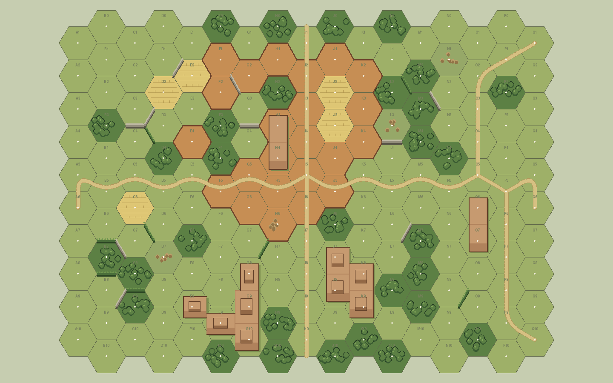
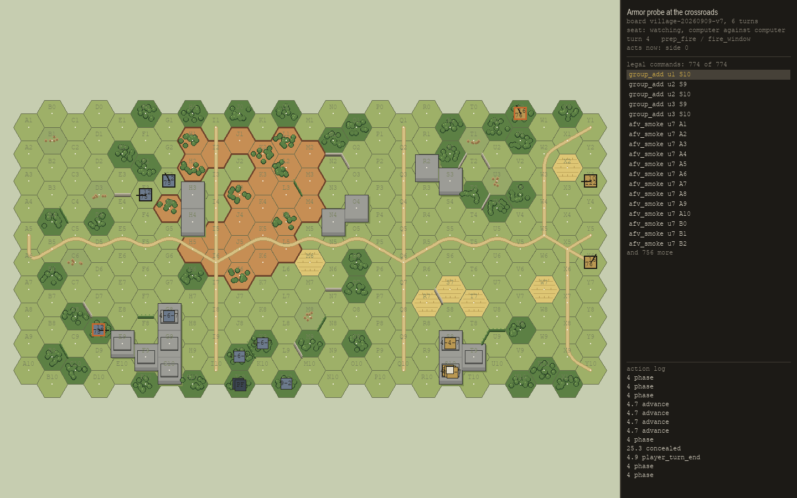

# Asset provenance

Where each thing the player sees comes from, and why none of it is Avalon Hill art.

The game ships no image file. There is no SVG and no font file in the tree, and no image
goes in the built client. Code draws each shape on the screen at run time, from numbers in
this repository.

The one directory with an image is `docs/images/`, and section 2 says what is in it and what
holds the rule. The release audit, `tools/audit_release.py`, gives a finding for an image
that is not in `background/` and not in that directory. `background/` is the owner's
reference material, and git does not record it (SR-07, TC-29).

This record answers item 4 of the counter rubric in `docs/SUCCESS_CRITERIA.md`: the
silhouette, the colours, and the typeface are new or open licence, and each asset has a
provenance note.

## 1. How the project made each asset

The rule for each asset is the same. A person read what the 1977 component looks like, then
wrote a sentence about it in the research documents, then wrote code from that sentence. No
person copied a scan, and no scan is in the repository. A description of a colour is a fact
about the world. A copy of the art is not, and the project holds none.

The shape of each terrain comes from a study of the owner's own boards. The owner
photographed them. The photographs are in `background/`, which git does not record. A person
looked at the photographs and wrote down what the eye sees. A wood is a mass of crowns with
a ragged edge. A building is a small brown shape that sits in its hex, and the ground shows
around it.

A road is a ribbon that turns in a hex. A hill is a flat brown area. A field is the one
terrain that fills its hex. Each of those is a fact about what a wood or a road looks like.
The code makes each shape from those sentences, with the colours and the geometry of the
project. No photograph, no scan, and no measurement of a printed shape is in the repository,
in a fixture, or in an artifact (SR-07, DR-01).

The look of a counter comes from the same kind of study. The owner photographed the 1977
pieces, front and back, and the photographs are in `background/`. A person looked at them
and wrote down what the eye sees, in `docs/research/2026-09-17_RV-10_counter_study.md`. A
piece is a die-cut cardboard chit.

A squad is two men above one line of numbers. A leader is one man with the name and the
value up the side. A weapon is an icon with three lines. A vehicle is a plan from above with
the numbers in the corners. The code makes each face from those sentences, with a layout
table and point lists of its own.

The chit is a square with round corners and a thickness that makes a small shadow. The light
is on one edge, and the shade is on the other. It has a pale cut edge where the knife cut the card. It has
wear at the corners. A broken unit shows the printed back of the counter. The code makes each
of those shapes with the project's own colours, and no pixel of a photograph is in the tree.

The window and the browser hold one set of colours. `src/slwindow/theme.py` has it, and
`client/src/board/render.ts` has the base tone of each terrain.
`tests/browser/test_render_constants.py` compares the two files. Thus one terrain has one
colour and not two.

The window adds flat shading on that tone: a lit face, a body, a shaded face, and a line.
Each face has one tone and a hard edge. The light comes from the top of the screen, so the
two hexes of a hexside make the same picture.

| Asset | Where it is | What it is | Where it comes from |
|---|---|---|---|
| Terrain fills | `src/slwindow/theme.py` `TERRAIN` and `client/src/board/render.ts` `FILLS` | Six flat colours: open, wheat, shell hole, woods, wooden building, stone building. The stone building is a light tan brown, and the wooden building is a darker red brown | The project chose them from the colour families that RV-2 section 1.4 records. The study of the owner's boards agrees that open ground is a light yellow-green, and that a building is brown and not grey. The project took no colour from a scan. |
| Hill shades | `src/slwindow/theme.py` `HILL` and `client/src/board/render.ts` `HILL_FILLS` | Three browns, one for each level of rule 43. A hex on a hill has the brown of its level and not the green of the ground | RV-2 section 1.4 records that the printed board shows a hill in shades of brown. The scan has three of them. The three browns are the project's own. |
| Crest lines | `src/slwindow/render.py` `_crest` and `client/src/board/render.ts` `drawCrestLines` | A brown line on each hexside where two levels touch | Rule 43.2 forms a crest line where two levels touch. The line shows that rule. |
| Woods mass | `src/slwindow/render.py` `_woods` | Eleven circles in four tones. The mass has a ragged edge and it is larger than the hex | The study says that a wood is a mass of crowns and not a green hexagon. The count, the radius, and the four tones are the project's own. Each circle gets its position from the reference of its hex. So a board makes the same picture each time, and the generator of the core is not touched. |
| Building plans | `src/slwindow/render.py` `_buildings` and `client/src/board/render.ts` `drawBuildings` | One small brown shape for each hex of the building. The shape sits in the hex and it is smaller than the hex, so the ground shows around it and it stays in the hex. A shape reaches out to a hex of the same building, so some hexes are one connected mass. Each shape has a roof, a wall face in the shade, and one line on each side that faces open ground | The study says that a building is a small brown shape in its hex. A building can cover some hexes as one connected mass. It is not four counters, and it does not fill a hex. Rule 7.5 gives a building of three hexes or more a second story. The second story is a smaller shape on the roof. The shapes and the tones are the project's own. |
| Roads | `src/slwindow/render.py` `_roads` and `client/src/board/render.ts` `drawRoad` | A ribbon that comes into a hex at one hexside and turns out at a different one. A junction is a straight arm to each hexside with a round middle | The study says that a road turns in a hex. The width, the shape, and the two browns are the project's own. It is not the road art of the printed board. |
| Wheatfields and shell holes | `src/slwindow/render.py` `_grain` and `_shellhole` | Lines across the hex for the rows of a crop (rule 44.2), and a group of small pits (rule 44.3) | The study says that a field is the one terrain that follows the hexsides. It also says that a shell hole hex is a group of small pits. The marks are the project's own. |
| Hexside features | `src/slwindow/render.py` `_hexsides` and `client/src/board/render.ts` `drawHexsides` | Three flat bands for a wall, a hedge, and a cliff: a lit top, the body, and the shadow | Rule 11.5 names the wall and the hedge. Rule 44.1 names the cliff. The three bands give each of them the height that stops a line of sight. The colours are the project's own. |
| Hex grid, centre dots, and labels | `src/slwindow/render.py` `_outline`, `_centre_dot`, and `_label`, and `client/src/board/render.ts` | Thin lines, a pale dot at the centre of each hex, and the hex name above the dot | Rule 3.5 says that each hex has its grid coordinate. Rule 7.1 threads a line of sight from one centre dot to the next, so the dot is a fact of the rules. The position and the weight of the line are the project's own. |
| Terrain polygons | `src/slboards/polygons.py` | Convex shapes on the integer lattice, one for each hex that blocks or decreases the line of sight | Written for this project, so that a line of sight can miss the trees in a hex. The shape set is small and hand written. |
| Board layouts | `src/slboards/generator.py` | Each board the game plays on | The generator makes them from a seed. No board in the repository is a transcription of one of the four 1977 boards. The audit gives a finding for a data file named after one (FR-27, TC-29). |
| Counter faces | `src/slwindow/counters.py` `LAYOUT` and `client/src/counters/draw.ts` `LAYOUT` | The layout of each face. A squad has two men above one line of numbers. A leader has one man at the left with the name and the value up the side. A weapon has its icon at the left and three lines at the right. A vehicle has its plan in the middle and its numbers in the corners | Made for this project from the sentences of RV-10 sections 3, 4, and 7. The table holds fractions of the face and no measurement of a printed piece. The two files hold one table, and `tests/browser/test_render_constants.py` compares them (SR-07). |
| Counter silhouettes | `src/slwindow/silhouettes.py` and `client/src/counters/silhouettes.ts` | Point lists in a unit box. There are five men: at a walk with a rifle, at a run with a submachine gun, on foot, on the ground, and on one knee. There are seven weapon icons, five vehicle plans, and a wreck | The project's own drawings from the sentences of RV-10. A line squad walks, an elite squad and a crew run, a leader stands, and a broken unit shows men down. No point is a measurement of a printed figure. The Russian men face right, so the renderer mirrors one figure for that army. The two files hold one set of lists, and the parity test compares them (SR-07, DR-01). |
| 3D counter | `src/slwindow3d/counters.py` | The counter as a rounded prism on the top of its hex. It shows a cardboard thickness, and the pale edge follows the rounded top. A stack is a messy pile: each counter leans some degrees and steps a small offset from its id | Made for this project. The top face is the same chit picture the pygame window makes, so the 3D piece and the 2D piece are the same. The lean and the offset come from the unit id and not from a generator, so a stack is the same in each session (SR-07, DR-01). |
| Counter physical look | `src/slwindow/counters.py` `_chit` and `client/src/counters/draw.ts` `drawChit` | The thickness shadow, the cut cardboard edge, the top-left highlight and the bottom-right shade of the bevel, and the corner wear | A study of the owner's photographs of the 1977 pieces. The photographs are in `background/`, and git does not record them. They show that a piece is a die-cut chit with rounded corners, a thickness, and wear at the corners. Each wear mark comes from the unit id and not from a generator, so a counter is the same in each session (SR-07, DR-01). |
| Counter stock colours | `src/slwindow/theme.py` `NATIONAL`, `BERSERK`, `MARKER`, `OPEN_TOP` and `client/src/counters/draw.ts` | Grey-blue for German, tan for Russian, yellow-green for American, and red for a berserk squad. White for a marker, a wreck back, and the plan of an open top vehicle. Each one is stronger than the colour of the ground, so a counter is the first thing the eye finds | RV-1 and RV-10 section 2 record the colour families. The values are the project's own. A support weapon is on the stock of its army, as the sheets show. |
| The turned counter, concealed, smoke, charge marks | `src/slwindow/counters.py` and `client/src/counters/draw.ts` | A broken unit is a counter turned to its back: the same stock, the word, the broken morale, and its men down. A weapon with a malfunction shows its icon below a white cross with R1 and X6. A wreck is a white back with the word, the plan, and the survival number. The concealment token is a question mark on the stock of its army. The smoke and the charge are flat colours and simple shapes | RV-10 section 5 records what the back of each piece shows. The word is the project's own. The marks for rules 12, 18, 25, 24, 23, and 33.9 are the project's own. |
| State tabs | `src/slwindow/counters.py` `_tabs` and `client/src/counters/draw.ts` `tabs` | Small tabs of the white marker stock at the top right of a counter: PF for a unit that fired in the Prep Fire Phase, M for one that moved, DM for desperation morale, R for a passenger | The 1977 game puts a white marker on the stack. The screen puts a tab on the counter in place of a second counter. The tabs are the project's own. |
| Typeface | `client/src/style.css` and the canvas fonts | Trebuchet MS, then Segoe UI, then the system sans-serif | A stack of fonts that are on the reader's machine. The project supplies no font file, so it gives out no typeface and no font licence is necessary. |
| Counter values, morale, range | `src/sldata/counters/*.json` | The numbers on each counter | RV-1 sections 2 to 6, with a provenance note in each file (DR-02). |
| Fire, close combat, terrain tables | `src/sldata/tables/*.json` | The numbers of the rules tables | Transcribed from the data card as RV-1 records, with a provenance note in each file (DR-01). A table of numbers that a rule uses is not art. |
| Scenario card | `src/slcards/card.py` and `src/slwindow/theme.py` `CARD_*` | A printable card for one scenario. It holds a title, a scenario number, the notes text, a board diagram, a turn record chart, and the victory conditions. It holds an order of battle area for each side | The layout is the project's own. A person looked at the 1977 scenario card and wrote down where each part sits. Every word on the card comes from the scenario JSON, the project's own text (FR-22). The mini-counters come from `slwindow.counters`. The side marks are simple project shapes. No card text and no card art of the 1977 game is in the module or in its output (SR-07, DR-01). |
| Card palette | `src/slwindow/theme.py` `CARD_PAPER`, `CARD_INK`, `CARD_RED`, `CARD_RULE`, `CARD_SHADE` | A cream paper, a dark ink, a red accent, a rule line, and a diagram fill | A scenario card is a paper document and not the green board. A person saw that the 1977 card is cream stock with black text and a red accent. The five values are the project's own. |
| 3D board view | `src/slwindow3d/mesh.py` and `src/slwindow3d/app.py` | The board as a set of hex prisms. The elevation of a hex lifts its prism a small step, so a hill stands up. The top of each prism shows the same 2D board picture the pygame window makes, and a light from above shades each side | Made for this project. The height comes from the elevation number of the hex. The top face reads the 2D board art of `slwindow.render` as a texture. So the woods, the buildings, and the roads are one drawing and not two. The counter cards use the same chit art. No scan and no printed board is the source of the shape. |
| Fire animations | `src/slwindow3d/effects.py` and `src/slwindow3d/firekinds.py` | A thin tracer line with a fading tail for each round of rifle, submachine gun, and machine gun fire. A gun fires a thin shell, and there is a flame, a rocket trail, a burst, smoke, and grenades. The tracer colour follows the army. It is red for American and British fire and green for German and Russian fire. One round in five of the green fire is white or yellow | The tracer colours of each army in the Second World War, as the owner gave them (2026-10-10). The shapes are the project's own and are not a copy of a picture. |

## 2. The pictures in this repository

`docs/images/` is the one directory of the tree that holds an image. Each file there is the
output of this project's own code. `tools/make_docs_images.py` makes the board with the
generator from a seed. Then it makes the picture with `slwindow` and writes the file.
`docs/images/MANIFEST.json` gives the seed, the board type, and what the picture shows.

A village board. The woods are a mass of crowns, and each building is a small brown shape
that sits in its hex. The road is a ribbon that turns, and the hill is a flat brown area
with a crest line. The grain fields are the one terrain that fills its hex.

The desktop window in turn 4 of scenario 4, with the counters and the panel.

Two things hold the rule that no scan gets in:

- The release audit gives a finding for an image in `docs/images/` that the manifest does
  not name, and for a manifest entry with no file. It gives one for an image in each other
  directory of the tree. It does not read `background/` (TC-29).
- `tests/docs/test_documentation_images.py` makes each picture again from the tool and
  compares it with the file in the tree. A picture that a person put there by hand does not
  pass.

## 3. The sounds

The project ships one recorded sound, the vehicle (section 3.1). Code makes each other
sound when the 3D window opens (`src/slwindow3d/sounds.py`), and the window plays it from
memory. Those sounds are noise, decay envelopes, filters, and low tones, and each one is the
project's own work:

| Sound | What the code makes |
|---|---|
| Rifle fire | A ragged volley of three to five shots. Each shot is a crack, a short body, and a low echo. |
| Submachine gun | Eight fast, light cracks. |
| Machine gun | A burst at a rate of fire. The German guns fire about 20 rounds each second, and the Russian and American guns about 9. |
| Flamethrower | A roar of filtered noise, with crackle. |
| Rocket | A launch hiss and a blast. |
| Tank gun | A crack, a deep boom that falls in pitch, and a long rumble. |
| Demolition charge | The largest blast, with debris. |
| Grenades | Two to four short, low bangs. |
| Smoke | A pop and a hiss. |
| One man moves | Four muffled footsteps: a low thud and a soft scuff, quieter than all weapons. |
| A squad moves | Four men who step out of time, with a soft rattle of equipment. A rout is the same, faster. |
| A vehicle moves | A part of 2.2 seconds of the tank recording (section 3.1), through a low-pass filter at 600 Hz, with a fade in and a fade out. Each of the three variants starts at a different place in the recording. It is quieter than a gun. |
| A vehicle breaks down | A hard clank of metal with partials that are not in tune, and a grinding noise that shakes about 30 times each second. Then the engine coughs four to six times, slower each time, and stops. It plays for the breakdown die of rule 39.1 and for a gun or machine gun that breaks (rules 38.1 and 38.2). |
| A vehicle crew repairs a gun | Groups of two or three hammer taps on steel, each followed by the clicks of a wrench. It plays for each repair attempt of rules 38.1 and 38.2, whatever the die gives. |

The random parts of each sound come from a generator with a fixed seed, so each run makes
the same sounds.

### 3.1 The tank recording

`src/slwindow3d/assets/tank_drive.wav` is a recording of a tank that drives. The owner made
the recording and holds its copyright, and the project license (GPL-3) applies to it.

The owner gave it on 2026-10-11 as `background/Tank_Noise.m4a` (48 kHz mono, 11.2 seconds)
and said to put it in the tree. `python tools/make_tank_sound.py` converts it to 16-bit
mono at 22,050 Hz: a three-tap low-pass filter, then a linear resample. The tool changes nothing else.

## 4. What the project does not have

- No scan, photograph, or screenshot of a 1977 component is in the repository, in a
  fixture, in a test, or in a run artifact.
- No board data file holds a layout read off one of the four printed boards.
- No font file is in the repository. The only sound file is the tank recording of section
  3.1. The only image files are the pictures of section 2, which this project's own code
  makes.
- The owner's own reference material is in `background/`, and `.gitignore` covers all of
  that directory. No file there goes into a commit, a build, or an artifact. The
  photographs of the owner's boards are in that directory, and the code holds no pixel of
  them.

## 5. Where the reference material is

`background/` holds the owner's copy of the rules and the photographs the owner took. It is
on the owner's machine, and git does not record it. `background/reference/` holds the text
that the research documents gave before. The project moved that text out of the tree, so
that no rulebook text and no card text ships (SR-07).

## 6. When to change this record

Add a row when the window or the client draws or plays something new. Say where the look comes from
before you write the code. A change to a colour or a shape does not make a new row
necessary. A new type of mark does. The counter rubric in `docs/SUCCESS_CRITERIA.md` scores this record, so
an asset with no row is an unsatisfactory item.
